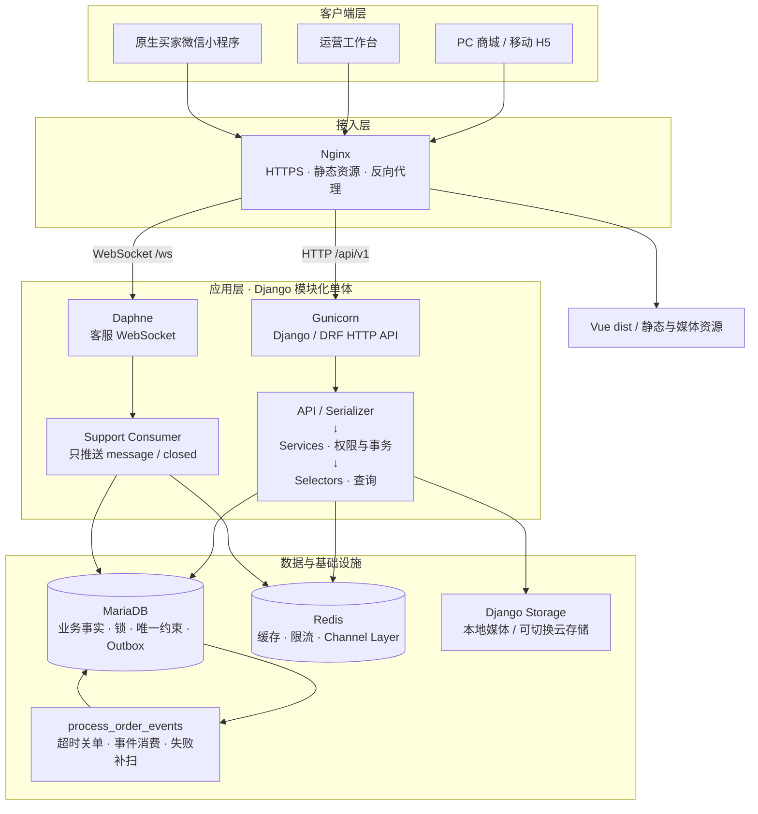
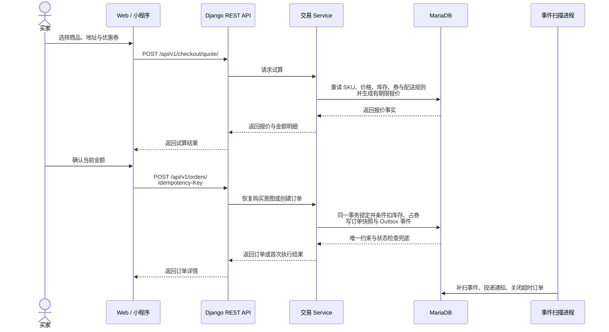

# SIQ 优选商城 · siq-mall-platform

SIQ 优选商城是一个面向自营零售场景的**单商家实物电商演示系统**。项目包含 PC 商城、移动 H5、运营工作台和原生买家微信小程序，由统一的 Django REST API 提供商品、购物车、试算、订单、优惠券、评价、通知、内容与客服能力。

系统重点不只是完成页面，而是验证一套可恢复的交易闭环：**服务端核价、数据库库存与券约束、订单快照、幂等重试、模拟支付、履约状态机、Outbox 事件投递和运营审计**。Web 与小程序共享业务规则，但分别处理导航、会话、生命周期和异常恢复。

> **当前代码基线：`ffafb7c`（2026-11-19，项目前端优化）**
>
> 业务架构对齐基线为 `c323fbc`。I01–I11 的本地业务闭环已实现；Ubuntu 24.04 原生预发、真实微信平台能力与真机、规定负载性能及人工签收仍需分别验收，详见[验收台账](docs/11-readiness-and-acceptance.md)。

## 目录

- [产品能力](#产品能力)
- [系统总体架构](#系统总体架构)
- [核心业务链路](#核心业务链路)
- [技术栈](#技术栈)
- [仓库结构与模块边界](#仓库结构与模块边界)
- [关键工程设计](#关键工程设计)
- [Windows 11 本地运行](#windows-11-本地运行)
- [配置与入口](#配置与入口)
- [API 契约](#api-契约)
- [测试与质量保障](#测试与质量保障)
- [生产部署与运维](#生产部署与运维)
- [项目边界与文档导航](#项目边界与文档导航)

## 产品能力

### 角色与端

| 角色 / 客户端 | 主要入口 | 已实现能力 |
| --- | --- | --- |
| 游客 · PC / H5 | `/`、`/products`、`/products/{id}` | 浏览已发布内容与在售商品、搜索筛选、选择规格、游客加购；登录后合并购物车。 |
| 买家 · PC / H5 | `/cart`、`/checkout`、`/orders` | 地址与优惠券选择、服务端试算、金额变化重新确认、提交结果找回、模拟支付、取消、收货与订单时间线。 |
| 买家 · 账户与服务 | `/account`、`/messages`、`/support` | 资料、地址、券包、评价、站内通知和客服会话；支持未读水位、消息补拉与失败重试。 |
| 买家 · 原生小程序 | 首页、购物车、我的三个标签页 | 14 个原生页面，覆盖选购、结算、订单恢复、支付查询、评价、地址、消息与客服；支持分享进入和弱网恢复。 |
| 商品 / 履约 / 营销运营 | `/ops/products`、`/ops/orders`、`/ops/coupons` | 分类树、多规格商品、价格与库存流水、上下架、订单发货、券模板与发放控制。 |
| 内容 / 审核 / 客服运营 | `/ops/cms`、`/ops/reviews`、`/ops/support` | CMS 草稿与发布、定时公告、评价审核、客服分配与回复；所有入口按业务权限显示。 |
| 权限管理员 / 审计员 | `/ops/access`、`/ops/audits` | 用户角色调整、会话撤销、跨模块历史审计；工作台 `/ops` 只汇总权限内真实待办。 |

### 核心特性

- **三端共用一套交易事实**：PC、H5 和小程序不各自计算最终应付，统一由后端读取商品、库存、地址、配送和券规则。
- **消费者与运营分布局**：商城采用暖白、深松绿品牌体系和响应式导航；运营后台采用独立高密度侧栏、表格与任务视图。
- **交易可恢复**：网络中断或响应未知时，按原购买意图、报价和幂等键查询或恢复，不通过盲目重放创建新订单。
- **数据库保证一致性**：库存、优惠券、订单和支付事实以 MariaDB 为准；Redis 用于缓存、限流与频道层，不单独承担防超卖或防超发。
- **异步最终可靠**：业务记录与 Outbox 事件同事务写入，扫描进程负责超时关单、事件投影、通知投递与失败补扫。
- **实时能力可降级**：客服使用 WebSocket 推送，发送、已读和历史仍走 HTTP；关闭实时开关或连接失败时回退增量轮询。
- **契约驱动联调**：OpenAPI 3.1 描述实际路由，前端契约类型由同一文件生成，避免多端手写类型漂移。

## 系统总体架构

### 架构原则

项目采用**模块化单体 + 独立客户端 + 数据库 Outbox**，而不是提前拆分微服务：

1. HTTP 视图与 serializer 负责输入输出，service 承载权限内的业务命令和事务，selector 负责查询。
2. 商品、订单、券、支付和审计等核心动作通过明确的服务接口完成，不用 signal 隐藏关键交易写入。
3. MariaDB 是业务事实源；Redis 是可替换的加速与协调组件，不是订单或库存的最终依据。
4. 客户端只保存交互状态和恢复所需标识，不在浏览器或小程序中决定价格、权限和履约状态。
5. 开发环境为 Windows 11；生产目标为 Ubuntu 24.04 原生部署，不引入 Docker 或 Kubernetes。

### 生产拓扑



生产进程中，Gunicorn 监听 `127.0.0.1:8001`，Daphne 监听 `127.0.0.1:8002`，TLS 在 Nginx 终止；订单扫描由 systemd timer/service 触发。开发环境则由 Vite 将 `/api`、`/media` 和 `/ws` 代理到本机 Django。

### 分层职责

| 层级 | 组成 | 核心职责 |
| --- | --- | --- |
| 客户端层 | Vue SPA、原生微信小程序 | 展示、交互、分端会话、页面生命周期、失败恢复；不持有业务最终裁决权。 |
| 接入层 | Vite 开发代理；生产 Nginx | 静态资源、HTTPS、HTTP/WebSocket 转发、安全请求头和追踪头。 |
| 接口层 | Django、DRF、serializer、FilterSet | 鉴权、参数校验、统一响应、限流、分页、过滤与 OpenAPI 契约。 |
| 领域层 | 各业务 app 的 services / selectors | 交易命令、权限范围、状态机、事务、锁顺序、快照、查询组装。 |
| 数据层 | MariaDB、Redis、Django Storage | 持久事实、约束与竞争控制；缓存和频道；图片及媒体存储。 |
| 异步层 | 数据库事件 + `process_order_events` | 至少一次投递、消费去重、超时关单、公告与通知、停机补扫。 |
| 运维层 | Gunicorn、Daphne、systemd、GitHub Actions | 进程托管、定时扫描、日志、质量门禁、MariaDB 集成回归。 |

## 核心业务链路

### 从试算到订单



下单时后端会重新核价；价格或履约信息变化时要求用户再次确认。订单保存商品、金额、优惠与地址快照，历史订单不随主数据变化。

### 状态与并发不变量

| 对象 | 合法状态 / 约束 |
| --- | --- |
| 订单 | `pending → paid / canceled`；`paid → shipped → completed`。不开放通用改状态或改金额接口。 |
| 模拟支付 | `init → success / failed`；支付不二次扣库存，成功金额必须等于订单应付。 |
| 用户券 | `unused → reserved → used`；取消或超时可释放，同一张券只能绑定一个活动订单。 |
| 库存 | 下单条件扣减并记录唯一业务流水；取消和超时只归还一次，数据库约束防止超卖。 |
| 幂等 | 同键同参数返回首次结果，同键异参返回 409；购买意图和永久业务流水唯一约束提供最终兜底。 |
| 客服会话 | `open → closed`；关闭后禁止发送，客服只能访问授权或已分配会话。 |

`Idempotency-Key` 用于业务命令去重，`X-Request-ID` 只用于请求追踪，两者不可混用。金额使用 `Decimal(12,2)`，JSON 以两位小数字符串输出，前端不得用浮点数推导最终应付。

### 客服实时链路

1. 客户端先通过 HTTP 获取一次性 `ws-ticket`，再以 `support.ticket.<票据>` 子协议连接 `/ws/support/{id}/`，不在 URL 中传 access token。
2. Daphne/Channels 只负责服务端 `message` 和 `closed` 推送；发送、已读、历史查询仍通过 HTTP 完成。
3. 客户端按消息 ID 与游标去重、补拉；断线后重连，并可回退到约 5 秒的增量轮询。
4. 设置 `SUPPORT_WS_ENABLED=0` 可关闭实时通道，不影响客服基本业务。

## 技术栈

| 类别 | 技术与版本基线 | 在项目中的用途 |
| --- | --- | --- |
| 开发 / 构建环境 | Windows 11、PowerShell、Python 3.12、Node 24.13.1 | 本地开发、依赖安装、测试和前端构建；Node 版本固定于 `.nvmrc`。 |
| Web 客户端 | Vue 3.5、Vue Router 4、Pinia 3、Vite 7 | PC 商城、移动 H5 与运营工作台；路由懒加载、状态管理和开发代理。 |
| Web 语言与 UI | TypeScript 5.9 strict、SCSS、Element Plus 按需导入 | 全量类型检查、品牌设计 token、商城组件与高密度运营表单/表格。 |
| Web 请求与契约 | Axios、openapi-typescript | 统一请求与 401 协调刷新；从 OpenAPI 生成 `src/types/api.d.ts`。 |
| 微信小程序 | 原生 JavaScript、WXML、WXSS、Node Test | 独立页面栈、tabBar、存储、分享和商城会话；不直接复用 Vue DOM 组件。 |
| 后端框架 | Django 5.2 LTS、DRF 3.16 | 模块化单体、HTTP API、序列化、权限、事务与 Admin。 |
| 身份与权限 | SimpleJWT 5.5、Django Group/Permission、AuthSession/Profile | access/refresh 轮换、会话撤销、角色与对象级权限；保留 `auth.User`。 |
| API 与过滤 | drf-spectacular 0.28、OpenAPI 3.1、django-filter 25 | 实际契约生成与校验、列表筛选白名单、错误与分页协议。 |
| 数据库 | MariaDB（MySQL 协议）、mysqlclient 2.2 | 业务事实、行锁、条件更新、唯一约束与事件回执；临时 MariaDB 11.8 已用于集成验证。 |
| 缓存 | Redis 7、django-redis、redis-py | 热点缓存、限流、会话协调；不作为库存与券的唯一事实源。 |
| 实时客服 | Channels 4.x、Daphne 4.x、channels-redis | 一次性 ticket 鉴权、消息推送、心跳和断线恢复。 |
| 异步任务 | 数据库 Outbox、Django management command | 持续扫描或 systemd timer；不并行引入 Celery。 |
| 内容与媒体 | Pillow 12、nh3、Django STORAGES | 图片真实内容/尺寸校验、富文本白名单清洗、本地或可切换云存储。 |
| 后端质量 | pytest、pytest-django、pytest-cov、Ruff、Black | 单元与集成测试、覆盖率、lint 和格式检查。 |
| 客户端质量 | Vitest、Node Test、Playwright Core / Chrome | 请求与会话测试、小程序业务边界、真实浏览器交易与权限链路。 |
| CI | GitHub Actions | backend、frontend、mini、MariaDB 四个独立作业；包含 OpenAPI 漂移检查。 |
| 生产运行 | Ubuntu 24.04、Nginx、Gunicorn、Daphne、systemd | 原生进程部署、TLS、静态资源、HTTP/WebSocket 分流、定时扫描和日志。 |

完整依赖范围见[后端依赖](backend/requirements.txt)、[后端锁文件](backend/requirements-dev.lock.txt)和[前端工程](frontend/package.json)。依赖升级必须结合任务目的和兼容验证，不以追求最新版本为目标。

## 仓库结构与模块边界

```text
siq-mall-platform/
├── backend/                    # Django 模块化单体
│   ├── config/                 # ASGI/WSGI、总路由、dev/test/prod/MariaDB 配置
│   ├── common/                 # 响应信封、异常、分页、请求 ID、公共基础设施
│   ├── accounts/               # 注册登录、JWT、Web/mini 会话与撤销
│   ├── users/                  # Profile、收货地址与默认地址
│   ├── catalog/                # 分类、SPU/SKU、价格、库存与媒体
│   ├── cart/                   # 游客/会员购物车、选中与合并
│   ├── orders/                 # 报价、订单、模拟支付、履约、事件扫描
│   ├── promotions/             # 券模板、领取、占用、核销与释放
│   ├── reviews/                # 订单项评价、公开评分与审核
│   ├── content/                # CMS、首页内容块、公告、草稿与发布
│   ├── notifications/          # 通知模板、站内信、游标与已读水位
│   ├── support/                # 客服会话、消息、分配、WebSocket 消费者
│   └── audit/                  # 跨模块运营事件查询与审计
├── frontend/                   # Vue 3 + TypeScript Web 应用
│   ├── src/api/                # 模块化 API 客户端
│   ├── src/components/         # 共享商品、内容、客服等组件
│   ├── src/layouts/            # 消费者布局与独立运营布局
│   ├── src/router/             # 路由、权限 meta、守卫与滚动行为
│   ├── src/stores/             # Pinia 用户与会话状态
│   ├── src/styles/             # 设计 token、全局样式与可访问性
│   ├── src/types/              # OpenAPI 生成类型与领域模型
│   └── src/views/              # 商城、交易、账户与运营页面
├── mini/                       # 原生微信小程序，独立 JS/WXML/WXSS
├── deploy/                     # 开发启动、数据库初始化、Nginx/systemd 模板
├── docs/                       # 架构、规则、契约、验收与部署文档
├── qa/                         # Windows 集成、浏览器、小程序与交付边界测试
└── .github/workflows/ci.yml    # 四作业持续集成
```

### 主要代码入口

| 主题 | 实现入口 |
| --- | --- |
| 后端路由与配置 | [总路由](backend/config/urls.py) · [公共配置](backend/config/settings/base.py) · [生产配置](backend/config/settings/prod.py) |
| 交易与事件 | [订单服务](backend/orders/services.py) · [扫描命令](backend/orders/management/commands/process_order_events.py) |
| 实时客服 | [ASGI 入口](backend/config/asgi.py) · [客服消费者](backend/support/consumer.py) |
| Web 路由与布局 | [Vue Router](frontend/src/router/index.ts) · [商城布局](frontend/src/layouts/DefaultLayout.vue) · [运营布局](frontend/src/layouts/OpsLayout.vue) |
| 小程序入口 | [页面清单](mini/app.json) · [请求与会话](mini/utils/api.js) · [小程序指南](mini/README.md) |

## 关键工程设计

| 问题 | 设计与实现 |
| --- | --- |
| 弱网下单后不知道是否成功 | 服务端绑定购买意图、报价和订单；客户端保留原意图与幂等键。响应未知时先查询原操作，切换地址或券后迟到的旧报价不能覆盖当前选择。 |
| 支付与超时关单同时发生 | 两者锁定同一订单并检查状态，只允许一个合法状态转移成功；库存与券只按预占记录消费或释放一次。 |
| Redis 故障或重启 | Redis 不承担订单、库存和券的最终约束；数据库唯一键、条件更新与事务仍可防止重复建单、超卖和超发。 |
| 异步事件失败或进程重启 | 业务与 Outbox 同事务，消费者业务与消费回执同事务；至少一次投递配合去重和后续补扫，不仅依赖 `on_commit` 唤醒。 |
| 新消息到达时“全部已读”误伤 | 通知列表、游标和已读水位共享同一签名上界，只标记该快照之前的消息。 |
| 定时公告提前泄露 | 发布产生版本事件；扫描时重新核对当前发布版本和有效时间，公开读取只访问已发布版本。 |
| 商品最低价排序拖慢列表 | 商品记录维护最低 SKU 价，创建和调价事务同步更新；读取可直接排序，并通过 EXPLAIN 与规模脚本核查。 |
| 越权访问与内部权限混用 | Group/Permission 决定功能范围，查询同时限制对象归属；对象越权返回 404，功能无权返回 403，前端隐藏按钮不构成授权。 |
| 上传与富文本安全 | 校验真实图片内容、解码尺寸和大小；富文本使用白名单清洗，公开预览不能读取草稿。 |
| 运营历史无法追溯 | 审计查询跨订单、支付、券、内容、审核、客服与权限事件，在数据库筛选和排序后分页装载详情。 |

## Windows 11 本地运行

### 1. 准备依赖

- Python 3.12
- Node 24.13.1（可依据 `.nvmrc` 切换）
- MariaDB；集成测试使用 11.8 系列
- Redis 7（Windows 可通过 WSL2 提供）
- 可选：本机 Chrome，用于完整浏览器冒烟

从仓库根目录打开 PowerShell。先创建开发数据库和专用账号，可参考[数据库初始化示例](deploy/init_db.sql)；示例密码必须替换为本机值，不要直接用于任何共享环境。

### 2. 安装后端并初始化数据库

```powershell
Push-Location backend
py -3.12 -m venv .venv
.\.venv\Scripts\python.exe -m pip install -r requirements-dev.lock.txt
if (!(Test-Path .env)) { Copy-Item .env.example .env }
Pop-Location
```

编辑 `backend/.env`，至少配置数据库、Redis 和开发密钥。不要覆盖已有 `.env`，也不要把真实凭据写入文档或提交到仓库。已有开发库应先备份并检查迁移计划：

```powershell
Push-Location backend
.\.venv\Scripts\python.exe manage.py migrate --plan
.\.venv\Scripts\python.exe manage.py migrate
Pop-Location
```

如需演示模拟支付，只在隔离开发库设置 `DEMO_PAYMENT_ENABLED=1` 并重启后端。生产配置固定关闭该能力。

### 3. 安装前端依赖

```powershell
Push-Location frontend
npm ci
Pop-Location
```

### 4. 启动开发进程

可使用仓库脚本同时启动 Django、Vite 和扫描进程：

```powershell
powershell -ExecutionPolicy Bypass -File deploy\start-dev.ps1
```

也可以在三个独立 PowerShell 窗口手动运行，便于观察日志：

| 进程 | 工作目录 | 命令 |
| --- | --- | --- |
| Django HTTP / ASGI | `backend` | `.\.venv\Scripts\python.exe manage.py runserver 127.0.0.1:8000` |
| Vue / Vite | `frontend` | `npm run dev -- --host 127.0.0.1` |
| 订单与事件扫描 | `backend` | `.\.venv\Scripts\python.exe manage.py process_order_events --watch` |

首次演示可在 `backend` 执行 `manage.py createsuperuser`，再通过 Django Admin 给独立演示账号分配 `catalog_operator`、`order_operator` 等相应业务组。先创建并上架有库存商品，再用买家账号完成加购、地址、结算与支付；履约账号随后发货，买家确认收货并评价。

### 5. 小程序联调

在微信开发者工具中导入 `mini/`，按团队私有配置提供 AppID，并核对 `mini/app.js` 中的 `globalData.apiBaseUrl`。开发机回环地址只适用于本机；体验版和真机必须配置设备可访问的 HTTPS 请求、媒体和 socket 域名。

当前小程序使用商城账号密码登录。微信身份换证、原生地址选择、订阅授权和实际送达仍待接入，不能用浏览器模拟结果替代平台验收。完整步骤见[小程序指南](mini/README.md)。

## 配置与入口

### 主要环境变量

| 变量 | 用途 / 注意事项 |
| --- | --- |
| `DJANGO_SETTINGS_MODULE` | 生产固定为 `config.settings.prod`；测试和 MariaDB 集成使用各自隔离配置。 |
| `DJANGO_SECRET_KEY` | 生产必须设置随机长密钥，缺失时启动失败。 |
| `ALLOWED_HOSTS` / `CORS_ALLOWED_ORIGINS` | 主机与浏览器来源白名单，按实际域名配置；CORS 不替代鉴权或 CSRF。 |
| `DB_ENGINE`、`DB_NAME`、`DB_USER`、`DB_PASSWORD`、`DB_HOST`、`DB_PORT` | 默认使用 MariaDB/MySQL 协议；SQLite 只用于快速自检与隔离单测。 |
| `REDIS_URL` / `CHANNEL_REDIS_URL` | 缓存与 WebSocket 频道层；后者留空时复用前者。 |
| `SUPPORT_WS_ENABLED` | 设为 `0` 可关闭客服 WebSocket 并回退 HTTP 轮询。 |
| `MALL_MEDIA_URL`、`MALL_MEDIA_ROOT`、`MALL_STORAGE_BACKEND` | 媒体访问路径、本地目录和可切换 Django Storage 后端。 |
| `DEMO_PAYMENT_ENABLED` | 仅隔离开发/演示环境开启；生产设置固定为关闭。 |
| `APP_VERSION` / `LOG_LEVEL` | 应用版本标识与日志级别。 |

开发示例见[backend/.env.example](backend/.env.example)，生产 systemd 环境模板见[deploy/backend.env.example](deploy/backend.env.example)。排障时只检查必要变量是否存在并脱敏，不打印真实环境文件。

### 本地访问入口

| 入口 | 地址 |
| --- | --- |
| 商城 / 运营工作台 | [http://127.0.0.1:5173/](http://127.0.0.1:5173/) |
| 服务状态页 | [http://127.0.0.1:5173/status](http://127.0.0.1:5173/status) |
| 后端健康探针 | [http://127.0.0.1:8000/api/v1/health/](http://127.0.0.1:8000/api/v1/health/) |
| 开发 Swagger UI | [http://127.0.0.1:8000/api/v1/docs/](http://127.0.0.1:8000/api/v1/docs/) |
| Django Admin | [http://127.0.0.1:8000/admin/](http://127.0.0.1:8000/admin/) |

健康探针在数据库或 Redis 依赖异常时返回 HTTP 503；生产模式不公开 schema 和 Swagger。

### 常见问题

| 现象 | 定位与处理 |
| --- | --- |
| 页面可打开，但状态页显示 503 | 按请求 ID 查看后端日志，分别检查 MariaDB、Redis 地址、账号和端口可达性。 |
| 能登录但没有运营入口或无法发货 | 核对账号所属业务组和对象权限，重新建立会话；发货只适用于已付款订单。 |
| 下单后没有站内通知 | 检查 `process_order_events` 是否运行，并核对事件回执、收件人和公告生效窗口。 |
| 浏览器可用，小程序真机无法请求 | 真机回环地址指向手机自身；检查 API 地址、HTTPS 域名、平台白名单和媒体/socket 配置。 |
| 修改接口后类型或 CI 漂移检查失败 | 重新生成并校验 `docs/openapi.yaml` 与前端类型，确认序列化器、错误码和客户端同步更新。 |

## API 契约

所有业务 API 使用 `/api/v1/` 前缀，资源采用复数路径和尾斜杠。GET 只读，POST 用于创建或业务动作，PATCH 局部更新，DELETE 删除；具体字段以[OpenAPI 3.1](docs/openapi.yaml)和[API 联调说明](docs/10-target-api-contract.md)为准。

当前契约包含 **95 个路径、113 个操作**，覆盖买家、运营和客服 `ws-ticket` 等实际路由。主要资源如下：

| 领域 | 代表性入口 |
| --- | --- |
| 健康与身份 | `health/`、`auth/register/`、`auth/login/`、`auth/logout/`、`users/me/` |
| 商品与购物车 | `categories/tree/`、`products/`、`carts/items/`、`carts/merge/` |
| 交易与支付演示 | `checkout/quote/`、`orders/`、`payments/`、`orders/{order_no}/receive/` |
| 地址与优惠券 | `users/me/addresses/`、`coupons/{id}/claim/`、`users/me/coupons/` |
| 评价、通知与 CMS | `reviews/`、`notifications/`、`notifications/read/`、`cms/home/` |
| 客服 | `conversations/`、`conversations/{id}/messages/`、`conversations/ws-ticket/` |
| 运营 | `/ops/` 下的商品、订单、券、CMS、评价、客服、角色和审计资源 |

成功响应采用统一信封：

```json
{
  "code": 0,
  "message": "ok",
  "data": {},
  "request_id": "...",
  "timestamp": "ISO8601"
}
```

失败响应保留正确的 HTTP 状态，`code` 为非零业务错误码，`data` 为 `null`，字段错误位于 `errors` 数组。普通列表使用 `page/page_size`，默认 20、最大 100；通知和聊天使用稳定游标，不与页码协议混用。

修改契约后，应同步 serializer、错误常量、OpenAPI、生成类型、客户端与测试：

```powershell
Push-Location backend
.\.venv\Scripts\python.exe manage.py spectacular --validate --fail-on-warn --file ../docs/openapi.yaml
Pop-Location
npm --prefix frontend run gen:api-types
```

## 测试与质量保障

### 本地质量门禁

下列命令从仓库根目录执行。标准后端 pytest 使用 SQLite 与内存缓存，适合隔离单测；行锁、死锁、条件更新和真实 Redis 行为必须通过 MariaDB/Redis 集成测试验证。

```powershell
Push-Location backend
.\.venv\Scripts\python.exe manage.py check
.\.venv\Scripts\python.exe -m pytest
.\.venv\Scripts\python.exe -m ruff check .
.\.venv\Scripts\python.exe -m black --check .
Pop-Location

npm --prefix frontend run lint
npm --prefix frontend run typecheck
npm --prefix frontend test
npm --prefix frontend run build
npm --prefix mini test
node --test qa/acceptance/mini-boundaries.cjs
```

需要真实数据库竞争、完整浏览器交易和隔离恢复时，额外运行：

```powershell
.\backend\.venv\Scripts\python.exe qa/windows/smoke.py
```

该脚本使用随机端口和临时 MariaDB，并通过本机 Chrome 执行商品、交易、审核、通知、客服和权限链路，不应指向现有业务数据库。

### CI 与验证层次

| 层次 | 覆盖内容 |
| --- | --- |
| Backend CI | Django check、pytest、Ruff、Black、OpenAPI 严格生成及漂移检查。 |
| MariaDB CI | 地址、库存、购物车、订单、券、评价、通知、内容、客服和交付边界集成测试。 |
| Frontend CI | ESLint、strict TypeScript、Vitest、生产构建。 |
| Mini CI | 会话/请求适配测试与报价、订单找回、支付、客服等页面边界测试。 |
| Windows 隔离冒烟 | 临时 MariaDB/Redis、真实 Chrome、worker 异常补扫、规模读取及 dump/restore 抽查。 |

### 已登记结果与证据边界

- 2026-11-19 前端优化复验：Web lint、typecheck、20 项 Vitest 和生产构建通过；小程序 4 项适配与 9 项边界测试通过。
- 同次 Windows 隔离冒烟：20 项 MariaDB 专项及完整浏览器业务链路通过，包含订单找回、支付履约、优惠券、评价、通知、CMS、客服、角色与审计。
- 1000 商品本机串行读取短测 P95 为 0.0630 秒；该结果不是规定并发、数据规模或生产 SLA 结论。
- 架构对齐基线登记：后端 99 项通过、14 项 MariaDB 专项在 SQLite 跳过，行覆盖率 95.01%；精确环境与历史数据见[验收台账](docs/11-readiness-and-acceptance.md)。

性能目标仍需在固定环境下实测：4 核 8GB、10 万商品/30 万 SKU/50 万订单，区分冷热缓存，覆盖 20/50/100/200 并发和规定预热/稳态时长。构建成功、单测通过或本机短测都不能替代性能、真机和人工验收。

## 生产部署与运维

### 原生部署单元

| 单元 | 职责 |
| --- | --- |
| Nginx | HTTPS、Vue 静态资源、媒体、HTTP/WebSocket 反向代理、请求头与超时配置。 |
| `mall-gunicorn.service` | 运行 Django HTTP API，监听 `127.0.0.1:8001`。 |
| `mall-daphne.service` | 运行客服 WebSocket，监听 `127.0.0.1:8002`；可通过开关独立降级。 |
| `mall-orders.timer` / `.service` | 定期执行订单关闭、事件消费和失败补扫。 |
| MariaDB / Redis | 仅监听受控地址，不暴露公网；使用独立账号与认证。 |
| journald | 收集生产 JSON 日志，避免多个 worker 竞争文件轮转。 |

生产配置唯一来源为 `/etc/mall/backend.env`，应用、Daphne、迁移和扫描进程必须读取同一版本配置。前端在受控构建机执行 `npm ci && npm run build`，服务器直接服务 `frontend/dist`，不必安装 Node。

### 发布与恢复要求

1. 固定并记录 MariaDB 系列，先在预发核对迁移、JSON、排序规则、事务和执行计划差异。
2. 发布前记录代码版本、前端构建、配置版本、迁移清单和待处理事件；数据库迁移采用 expand/contract。
3. 验证 HTTP→HTTPS、前端深链接、健康探针 200/503、生产文档 404、WebSocket 与轮询回退。
4. 数据库和媒体同时备份并异机保存；目标 RPO ≤15 分钟、RTO ≤2 小时，必须由恢复演练证明。
5. 回滚代码不等于自动回滚数据库。先确认旧代码兼容当前表结构，再切换版本并复查扫描积压和业务状态。

完整命令、模板和回滚边界见[Ubuntu 24.04 原生部署手册](docs/14-native-deployment.md)。Windows 自动测试结果不能写成 Ubuntu、TLS 或生产恢复已经通过。

## 项目边界与文档导航

### 当前不包含

- 多商户、拆单、跨境税费、秒杀和独立 App。
- 真实支付、真实退款、对账与完整售后；当前仅为隔离环境模拟支付。
- 已核验的微信身份登录、平台地址、订阅消息实际送达及真机兼容矩阵。
- 未经实测的 Ubuntu 预发、生产性能、高可用或灾备承诺。

商业上线前需另立真实支付、退款、物流、对账、隐私合规和运维保障项目。自动验证通过、人工验收通过与上线许可必须分别登记。

### 文档地图

| 阅读目标 | 文档 |
| --- | --- |
| 了解系统需求与技术约束 | [01 开发架构](docs/01-architecture.md) |
| 理解三端页面、视觉与权限 | [06 移动与微信设计](docs/06-mobile-wechat-design.md) · [08 页面与权限](docs/08-product-and-experience-spec.md) |
| 修改领域规则或联调接口 | [09 规则与数据](docs/09-domain-and-data-spec.md) · [10 API 联调](docs/10-target-api-contract.md) · [OpenAPI](docs/openapi.yaml) |
| 接手开发或定位任务 | [07 开发交接](docs/07-predevelopment-handoff.md) · [02 迭代计划](docs/02-iteration-plan.md) · [协作约定](AGENTS.md) |
| 查看验证和人工验收状态 | [11 验收台账](docs/11-readiness-and-acceptance.md) · [12 总验收](docs/12-final-acceptance.md) · [13 独立复验](docs/13-independent-acceptance.md) |
| 了解架构对齐改造 | [15 架构对齐任务书](docs/15-architecture-alignment-task-book.md) |
| 本地联调与生产发布 | [小程序指南](mini/README.md) · [14 Ubuntu 原生部署](docs/14-native-deployment.md) |
| 追溯早期设计与验证 | [03 I01 原始登记](docs/03-iteration-01-acceptance.md) · [04 早期工程审查](docs/04-project-review.md) · [05 基础框架复验](docs/05-review-validation-2026-11-06.md) |

文档描述设计与证据，实际功能以当前路由、serializer、服务、数据库约束和测试共同核对。发现文档与代码冲突时，应先明确现状与目标并同步修正，不得暗改公共协议。
