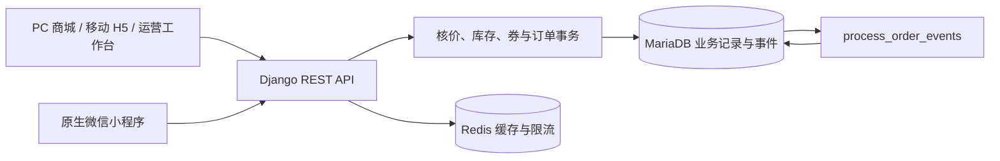

# SIQ 优选商城 · siq-mall-platform

SIQ 优选商城是一个单商家实物电商演示项目。买家可以从商品详情选规格、领券下单、模拟付款，到签收后评价。运营人员在同一套业务数据上维护商品、发货、审核评价、发布内容和回复客服消息。PC 商城与移动 H5 共用 Vue 应用，买家微信小程序独立实现，三端由 Django 统一核价和校验权限。

**当前交付基线为 `17f5b91`。** I01–I11 已形成可在 Windows 本地演示的业务闭环，独立验收发现的八项问题已修复。Ubuntu 24.04 部署、微信平台接入与真机、规定负载性能、人工签收各有独立的待验项。[逐项复验结果](docs/13-independent-acceptance.md)

## 从一笔订单看产品

| 操作者 | 实际入口 | 可演示的动作 |
| --- | --- | --- |
| 买家 · PC / H5 | `/`、`/products`、`/cart`、`/checkout` | 首页读取已发布内容，选择规格与数量，登录合并游客购物车，比较运费与券后应付金额。 |
| 买家 · 交易与账户 | `/orders`、`/account`、`/account/addresses`、`/account/coupons` | 找回提交结果、模拟支付、查看履约记录、确认收货、管理收货地址与券包。 |
| 买家 · 售后沟通 | `/account/reviews`、`/messages`、`/support` | 按已完成订单项评价，查看审核结果、站内通知，跟进客服会话。 |
| 买家 · 小程序 | 首页、购物车、我的三个原生标签页 | 从分享进入商品详情，手填地址、试算选券、恢复订单、查询模拟支付及回复。商城账号可登录；微信身份、平台地址和订阅送达仍待接入。 |
| 商品、履约、营销运营 | `/ops/products`、`/ops/categories`、`/ops/orders`、`/ops/coupons` | 维护多规格、库存流水和分类树，发布商品或券，处理已付款订单。 |
| 内容、客服及权限运营 | `/ops/cms`、`/ops/reviews`、`/ops/support`、`/ops/access`、`/ops/audits` | 预览草稿、定时发布、审核评价、分配会话、调整角色、追查业务动作。工作台 `/ops` 按权限显示真实待办。 |

首次演示可先由受信任的管理员给测试账号分配 `catalog_operator` 和 `order_operator`，创建并上架有库存的商品。另用买家账号完成加购、添加地址和结算，再切回履约账号发货。模拟支付须在隔离开发环境显式设置 `DEMO_PAYMENT_ENABLED=1` 后重启后端，生产配置固定关闭。客服分配、消息到达和评价审核的演示步骤见[总验收报告](docs/12-final-acceptance.md)。

## 技术栈与仓库结构

| 层 | 本项目使用的技术 | 负责什么 |
| --- | --- | --- |
| Web | Vue 3.5、Vue Router 4、Pinia 3、Axios、Vite 7、SCSS、Element Plus | 响应式商城、路由与会话状态、统一请求、运营表格与表单。依赖按 npm 锁文件安装。[前端工程](frontend/package.json) |
| 微信小程序 | 原生 JavaScript、WXML、WXSS、微信页面栈与本地存储 | 独立导航、分享、弱网恢复和商城会话。页面共用交易 API。[小程序指南](mini/README.md) |
| HTTP 与身份 | Python 3.12、Django 5.2、DRF 3.16、SimpleJWT、drf-spectacular | 模块化单体、序列化与权限、JWT 和服务端会话撤销、OpenAPI 3 契约。[后端依赖](backend/requirements.txt) |
| 数据与任务 | MariaDB / PyMySQL、Redis / django-redis、Django 管理命令 | MariaDB 保存业务事实、锁和事件回执；Redis 提供缓存及限流；扫描进程处理超时和事件。 |
| 媒体与内容 | Pillow、nh3、版本化内容块 | 校验上传图片、清洗富文本。草稿、预览与公开版本分开读取。[内容服务](backend/content/services.py) |
| 验证与部署 | pytest-django、pytest-cov、Vitest、Node Test、Playwright/Chrome、Nginx、Gunicorn、systemd | 从隔离单测到真实 MariaDB 竞争与浏览器交易，配有 Ubuntu 原生部署模板。[验证脚本](qa/windows/smoke.py) · [部署手册](docs/14-native-deployment.md) |

在一次结算中，三个客户端做相同的事：向同一个服务索取报价，然后提交已确认的报价。后台扫描与在线请求独立运行，用户关掉页面后，订单仍可超时关闭，已提交的事件仍可投递。



## 值得查看的工程设计

| 用户会遇到的问题 | 实现机制与可核查的结果 |
| --- | --- |
| 弱网下已点下单，却看不到结果 | 服务端把购买意图绑定账号，原报价关联唯一订单。小程序保留原报价、意图与幂等键，购物车已清空时也可找回。切换地址或券后，迟到的旧报价不能覆盖当前选择。[订单服务](backend/orders/services.py) · [小程序反例测试](qa/acceptance/mini-boundaries.cjs) |
| 用户付款与关单任务同时发生 | 下单预占库存及优惠券，支付只消费预占，取消或超时释放。支付与关单锁定同一订单，结算记录约束单笔成功；数据库同时校验应付等式。验收包含 50 抢 10 库存及 100 抢 50 券。[并发验收台账](docs/11-readiness-and-acceptance.md) |
| 定时公告提前泄露，或“全部已读”误读刚到的消息 | 发布产生版本事件，扫描时再核对当前版本及有效时间；通知序号、分页游标与签名已读水位共享同一上界。测试在取数与标记间插入新消息，确认它仍为未读。[通知服务](backend/notifications/services.py) · [边界测试](qa/acceptance/test_delivery_boundaries.py) |
| 商品越多，按最低售价排序越慢 | 将最低 SKU 价维护在商品记录上，在创建、调价事务中更新，并回填历史数据。10 万商品、30 万 SKU 的本机串行短测中，P95 从 5.7810 秒降至 0.2500 秒；20 并发优化后为 0.8440 秒。硬件、并发和时长决定数字的适用范围。[规模测试](qa/windows/scale.py) · [测量记录](docs/11-readiness-and-acceptance.md) |
| 运营需要解释“谁在什么时候做了什么” | 审计从八类事件读取，先在数据库过滤、合并和排序，再装载本页详情。授权审计员能从超过 100 条记录的历史中查到旧事件；客服仍只访问所分配会话。[审计查询](backend/audit/api.py) · [权限与页面规格](docs/08-product-and-experience-spec.md) |

## Windows 11 快速启动

准备 Python 3.12、Node 24、MariaDB 和 Redis。可在 Windows 运行 MariaDB，在 WSL2 提供 Redis。从仓库根目录打开 PowerShell，创建开发库和专用数据库用户；SQL 示例中的密码须换成本机值。[数据库初始化示例](deploy/init_db.sql)

```powershell
cd backend
py -3.12 -m venv .venv
.\.venv\Scripts\python.exe -m pip install -r requirements-dev.txt
if (!(Test-Path .env)) { Copy-Item .env.example .env }
```

在本机 `backend/.env` 配置 `DJANGO_SECRET_KEY`、`DB_NAME`、`DB_USER`、`DB_PASSWORD`、`DB_HOST`、`DB_PORT` 和 `REDIS_URL`。已有开发库先备份并审核迁移计划，以下命令从上一步的 `backend` 目录继续。

```powershell
.\.venv\Scripts\python.exe manage.py migrate --plan
.\.venv\Scripts\python.exe manage.py migrate
cd ..\frontend
npm ci
cd ..
powershell -ExecutionPolicy Bypass -File deploy\start-dev.ps1
```

首次本地演示如需管理账号，可在 `backend` 用项目 Python 执行 `manage.py createsuperuser`，通过 Django Admin 给独立的演示人员分配相应组。商品进入上架状态后，游客即可从首页或商品列表进入详情。

打开 [本地商城](http://127.0.0.1:5173/) 和 [服务状态页](http://127.0.0.1:5173/status)。脚本同时启动 Django、Vite 和扫描进程。手工运行时分别在 `backend` 执行 `manage.py runserver` 与 `manage.py process_order_events --watch`（用项目虚拟环境的 Python），在 `frontend` 执行 `npm run dev`。健康探针 `/api/v1/health/` 在数据库或缓存依赖异常时返回 HTTP 503。开发模式可打开 [本地 Swagger UI](http://127.0.0.1:8000/api/v1/docs/)。

### 首次运行常见问题

| 现象 | 定位与处理 |
| --- | --- |
| 页面打开但服务状态为 503 | 查看状态页与后端日志中的请求 ID，分别检查开发库连接、Redis 地址及服务可达性。 |
| 能登录但看不到待办或无法发货 | 确认测试账号获授对应业务组，重新登录；发货要求订单已付款。 |
| 提交成功后站内通知未出现 | 核对扫描进程运行状态和日志。在开发库核对收件账号、事件回执和公告生效窗口。 |
| 浏览器能访问，小程序真机无法请求 | 真机的回环地址指向手机自身，核对小程序 API 地址、HTTPS 域名与账号配置。[小程序配置](mini/README.md) |

## 如何复验

下列命令均从仓库根目录开始。标准后端 pytest 使用 SQLite 与内存缓存。Windows 集成脚本会在随机端口启动临时 MariaDB，并用本机 Chrome 走用户路径，需先安装 MariaDB 11.8、Chrome 和上述项目依赖。

```powershell
Push-Location backend
.\.venv\Scripts\python.exe -m pytest
.\.venv\Scripts\python.exe -m ruff check .
.\.venv\Scripts\python.exe -m black --check .
Pop-Location
npm --prefix frontend run lint
npm --prefix frontend test
npm --prefix frontend run build
npm --prefix mini test
node --test qa/acceptance/mini-boundaries.cjs
.\backend\.venv\Scripts\python.exe qa/windows/smoke.py
```

| 基线 `17f5b91` 的证据 | 已登记结果 |
| --- | --- |
| 后端与数据库 | 后端原有 95 项通过，14 项 MariaDB 专项在 SQLite 跳过，行覆盖率 95.60%。临时 MariaDB 执行 14 项专项及 6 项补充用例，共 20 项通过；这 6 项在 SQLite 也单独通过。 |
| 客户端 | Web 的 19 项 Vitest、lint、生产构建通过。小程序原有 4 项适配测试和新增 9 项页面测试通过。 |
| 端到端 | Windows/Chrome 交易、运营、消息、客服流程通过；隔离恢复后四张抽查表计数一致。1000 商品本机串行读取 20 次的 P95 为 0.0630 秒。 |

精确复测命令与环境边界见[独立验收报告](docs/13-independent-acceptance.md)。生产目标是 Ubuntu 24.04 直接部署；发布前仍需实测 TLS、systemd、数据库与媒体异机恢复、规定负载、微信工具与真机，并取得人工验收记录。[部署与回滚手册](docs/14-native-deployment.md)

## 文档导航

| 读者任务 | 文档 |
| --- | --- |
| 了解技术与产品设计 | [01 开发架构](docs/01-architecture.md) · [06 移动与微信设计](docs/06-mobile-wechat-design.md) · [08 页面与权限](docs/08-product-and-experience-spec.md) |
| 实现功能或联调 | [07 开发交接](docs/07-predevelopment-handoff.md) · [09 规则与数据](docs/09-domain-and-data-spec.md) · [10 API 使用说明](docs/10-target-api-contract.md) · [OpenAPI](docs/openapi.yaml) · [协作约定](AGENTS.md) |
| 按任务复验与签收 | [02 迭代计划](docs/02-iteration-plan.md) · [11 验收台账](docs/11-readiness-and-acceptance.md) · [12 总验收](docs/12-final-acceptance.md) · [13 独立复验](docs/13-independent-acceptance.md) |
| 查看演进过程 | [03 I01 原始登记](docs/03-iteration-01-acceptance.md) · [04 早期工程审查](docs/04-project-review.md) · [05 基础框架复验](docs/05-review-validation-2026-11-06.md) |
| 本地运行及发布演练 | [小程序指南](mini/README.md) · [14 Ubuntu 原生部署](docs/14-native-deployment.md) |
