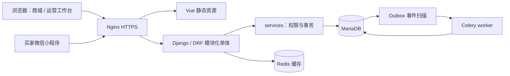

# 优选商城开发架构文档

版本：v2.2｜日期：2026-11-06｜状态：AI 修订稿，待人工审核。
本文仅定义需求与技术架构，不包含迭代排期。实施顺序见《02-iteration-plan.md》。

设计交付入口见[07](07-predevelopment-handoff.md)；页面/权限、规则/数据、目标接口分别见08–10。当前I01实际路由仅health和旧JSON refresh，认证迁移草稿未接入，I02–I11目标见02/10。I01修复与本次验证证据见[11登记](11-readiness-and-acceptance.md)，不能以历史报告推断当前已通过。

## 1. 产品定位与范围

面向自营零售的单商家在线电商网站。采用模块化单体，先把交易闭环、运营效率和体验做好；仅在实际负载和组织分工需要时拆分服务。

客户端设计范围现包含PC商城、移动H5和买家微信小程序。运营后台以PC为主，窄屏支持必要查询与履约。三端共用业务API和交易规则，登录、导航、地址、通知、分享与生命周期分别适配。详细设计与边界见[移动H5与微信小程序联合设计](06-mobile-wechat-design.md)；当前仅设计，未实现小程序。

| 模块 | 必需能力 | 角色 / 约束 |
| --- | --- | --- |
| F01 基础框架 | 分环境配置、统一 API、日志、健康检查、部署、质量门禁 | 开发 / 运维 |
| F02 身份 | 注册、登录、刷新、退出、改密、账号状态 | 买家；客服/运营独立授权 |
| F03 商品 | 分类、SPU/SKU、规格、图片、价格、库存、搜索、上下架 | 游客可浏览；运营维护 |
| F04 购物车 | 加购、改量、删除、选中、游客合并 | 加购不锁库存；价格以结算服务为准 |
| F05 交易 | 试算、订单、模拟支付、取消、关单、发货、收货 | 本期只演示支付，不收真实款项 |
| F06 用户中心 | 资料、地址、交易记录、改密 | 只读写本人资源 |
| F07 优惠券 | 模板、领取、试算、占用、核销、释放、过期 | 数据库保证不超发 |
| F08 评价 | 已完成订单项评价、评分、文字、审核 | 图片评价为可选扩展 |
| F09 消息 | 模板、个人通知、未读数、已读 | 订单事件可靠投递 |
| F10 CMS | 首页楼层、Banner、推荐、公告、单页 | 草稿、预览、发布、下线 |
| F11 客服 | 会话、用户消息、客服回复、未读、历史 | 初期 HTTP 增量轮询 |

面向消费者的商城与内部运营工作台分布局、分路由、分权限。Django Admin 是初期管理工具；商业化工作台应支持商品编辑、订单履约、券配置、内容发布、客服处理和操作审计。

本期不含多商户结算、真实支付、真实退款、跨境税费、秒杀、App。商业上线前必须另立真实支付、售后退款、物流、对账及运营合规项目；演示支付完成不等于可收款上线。

## 2. 技术架构与环境

| 层级 | 技术基线 | 约束 |
| --- | --- | --- |
| 开发系统 | Windows 11 | Python venv；PowerShell；Redis 可用 WSL2 原生安装 |
| 生产系统 | Ubuntu 24.04 LTS | 直接部署，禁止引入 Docker/Kubernetes |
| 前端 | Vue 3.5、Vite 7、Router 4、Pinia 3、Axios、SCSS | 当前 JS；新业务逐步引入 TypeScript 和契约类型 |
| 微信小程序客户端 | 独立构建/发布，原生或跨端方案待能力验证 | 不直接复用Vue DOM组件；共用后端业务契约，平台能力独立适配 |
| UI | Element Plus 按需导入 | 后台优先；商城使用独立品牌组件 |
| Node | 构建使用 Node 24，经锁文件验证 | Vite 7 最低要求 20.19+ 或 22.12+；不写笼统的 ≥20 |
| 后端 | Python 3.12、Django 5.2 LTS、DRF 3.16 | HTTP API + services 事务层 + selectors 查询层 |
| 鉴权 | SimpleJWT | Bearer access；refresh 轮换与黑名单 |
| 数据库 | MariaDB，MySQL 协议 | Ubuntu 默认源为 10.11；本机原记录为 11.8；发布前固定同一系列并验证 |
| 缓存 | Redis 7、django-redis | 热点缓存、限流；不作为库存/券的唯一事实来源 |
| 异步 | Celery + Redis | 仅异步业务启用；Windows 开发可使用 WSL2 worker |
| 部署 | Nginx + Gunicorn + systemd | Gunicorn 只监听 127.0.0.1:8001；TLS 在 Nginx 终止 |

MariaDB 与 MySQL 的协议兼容不等于 JSON、排序规则、条件索引、执行计划完全相同。若声明支持 MySQL，应增加 MySQL 8 的迁移与关键事务集成测试。PyMySQL 当前可用，但采用 MySQLdb 兼容入口，Django 更新必须验证驱动兼容性。

模块边界：视图负责 HTTP 与序列化，services 负责业务不变量与事务，selectors 负责查询。订单保存商品、价格、优惠、地址快照，避免历史订单随主数据变化。跨模块写操作调用明确的服务接口；不以 signal 隐藏关键交易动作。

## 3. 身份、权限与会话

本节浏览器Cookie目标方案适用于PC/H5。小程序商城会话、外部身份映射和跨端账号绑定按《移动H5与微信小程序联合设计》§3执行，不能把微信平台登录态等同于商城登录态，也不能按昵称/头像自动合并用户。

现有数据库已经使用 Django 默认 User，不能直接改 AUTH_USER_MODEL 后运行 migrate。当前低风险路径是保留 auth.User，用一对一 Profile 保存唯一手机号、昵称等字段，并以认证后端支持手机号登录。若人工决定采用自定义 User，必须在独立新库完成初始迁移、数据搬迁和回滚演练，不能清空现有数据库来绕过问题。

| 角色 | 权限范围 |
| --- | --- |
| 游客 | 在线商品与公开 CMS |
| 买家 | 本人资料、地址、订单、券、评价、会话 |
| 客服 | 已授权/已分配会话及必要订单摘要；禁止修改金额 |
| 运营 | 商品、CMS、优惠券、履约；敏感操作审计 |
| 管理员 | 角色与权限管理；日常操作不使用超级账号 |

使用 Django Group/Permission 配合对象范围过滤；is_staff 不等于所有运营业务权限。访问他人对象返回 404；无功能权限返回 403。禁止只依靠前端隐藏按钮。

当前骨架 access 2h、refresh 7d，分别存 sessionStorage/localStorage，属于演示实现。商业目标为 access 15min 存内存，refresh 放 Secure/HttpOnly/SameSite Cookie，配套 CSRF 令牌及 Origin 校验；不能只改存储位置而遗漏后端刷新协议。跨标签刷新需协调，防止 refresh 轮换冲突。改密、禁用与退出全端要定义 access 撤销策略（会话版本/撤销记录），仅拉黑 refresh 不代表现有 access 立即失效。

## 4. 交易一致性与状态机

### 4.1 下单与金额

结算服务重新读取 SKU 状态、实时价格、库存和券规则，拒绝信任客户端合计。客户端展示试算值，确认下单时后端重新试算；价格变化返回冲突并要求再次确认。

`payable = goods_amount + freight_amount - discount_amount`，每个金额非负，应付不低于零。货币默认为 CNY，金额用 Decimal(12,2)，JSON 返回十进制字符串；前端禁止用浮点计算最终应付。优惠分摊使用确定性尾差分配，明细分摊之和等于订单优惠。

下单在同一事务中：锁定涉及的 SKU（按 ID 排序）→ 条件扣库存 → 占用券 → 写订单与地址/商品快照 → 写事件。数据库死锁有限重试，且使用原幂等键。库存流水以业务号唯一，取消/超时只补回一次；库存不足返回 409。

### 4.2 幂等

X-Request-Id 仅用于链路追踪，不作为业务幂等键。下单、领券、模拟支付、消息重试使用 Idempotency-Key；数据库唯一约束 `(actor_id, operation, key)`，同时保存请求摘要、处理状态、资源号和结果。

同键同参数返回首次结果；同键不同参数返回 409；处理中返回可重试冲突与 Retry-After。订单幂等记录保留至少 7 天，购买intent与用户的唯一关系及支付/库存流水业务唯一约束永久保留；清理短期响应记录不能造成重复建单。Redis 只优化竞争，Redis 重启不能造成重复订单或超发。

### 4.3 状态

| 对象 | 合法流转 | 必须满足的不变量 |
| --- | --- | --- |
| 订单 | pending → paid / canceled；paid → shipped；shipped → completed | 不允许支付已取消订单；完成需用户收货或明确规则 |
| 支付演示 | init → success / failed | 成功通知幂等；支付金额必须等于订单金额 |
| 用户券 | unused → reserved → used；reserved → unused / expired；unused → expired | 同一张券只能绑定一个活动订单；支付时核销 |
| 会话 | open → closed | 关闭后禁止发送；另建会话需满足活动会话唯一性 |

模拟支付与超时关单竞争时先锁同一订单；只有一个状态转移成功。退款是商业扩展状态机，不能在尚无接口和验收时宣称已支持。真实支付接入需要验签、对账、退款和异常补偿，不是替换一个 adapter 就结束。

模拟支付使用显式环境开关；生产默认禁用，只有隔离演示环境可开启。用户只能操作本人的支付单，不对公网开放任意订单号的无鉴权 mock callback。

### 4.4 异步可靠性

交易与 Outbox 事件同事务提交；worker 至少一次投递，消费者以 `(event_id, consumer)` 去重。on_commit 可用于快速唤醒，但定时扫描数据库兜底，避免提交后进程退出导致事件丢失。关单以数据库 expires_at 为依据，单一 beat 调度 + 可重复执行任务。Redis broker 与缓存使用不同实例或明确容量隔离；仅不同逻辑库不能隔离内存淘汰风险。

## 5. 接口契约

统一前缀 `/api/v1/`，资源复数，尾斜杠；GET 只读，POST 创建/动作，PATCH 局部更新，DELETE 删除。新增字段向后兼容，破坏性变更走版本升级。

成功：`{code:0,message:"ok",data:{...},request_id:"...",timestamp:"ISO8601"}`。
失败：相同信封，code 非零，data=null，字段校验附 `errors:[{field,detail}]`。HTTP 状态仍表达失败，不能统一返回 200。

| HTTP | 语义 / 错误码 |
| --- | --- |
| 200 / 201 | 查询 / 创建成功 |
| 400 | 参数错误 10001 |
| 401 / 403 | 未认证 10002 / 无权限 10003；保留 WWW-Authenticate |
| 404 / 405 | 不存在 10004 / 方法错误 10007 |
| 409 | 业务冲突，使用对应模块码 |
| 429 | 限流 10005；保留 Retry-After |
| 500 | 内部异常 10006，不公开堆栈、连接地址或密码 |
| 503 | 基础依赖降级；当前 health 兼容契约为 code=0、data.status=degraded，监控以 HTTP 为准 |

错误码：20xxx 身份、30xxx 商品、40xxx 订单、50xxx 支付、60xxx 券、70xxx 评价、80xxx 通知、90xxx CMS/客服；集中常量定义。

页码分页 `page/page_size`，默认 20、最大 100，返回 `count/page/page_size/total_pages/results`，与现有StandardPagination一致。商品、运营列表和个人订单采用页码；通知/聊天接口采用收件人/会话事务序号与ID组成的独立稳定游标，返回`results/next_cursor/has_more`，避免晚提交消息被时间水位遗漏。不可中途静默切换分页协议。筛选排序白名单化，详见09数据模型和10目标接口契约。

| 模块 | 主要接口 |
| --- | --- |
| 基础（现有） | GET health/；POST auth/refresh/；开发环境 schema/、docs/ |
| 身份 | POST auth/register/、login/、logout/；GET/PATCH users/me/ |
| 商品 | GET categories/tree/、products/、products/{id}/ |
| 购物车 | GET/POST carts/items/；PATCH/DELETE carts/items/{id}/；POST carts/merge/ |
| 交易 | POST checkout/quote/、orders/；GET orders/{order_no}/；POST orders/{order_no}/cancel/、receive/ |
| 支付演示 | POST payments/、payments/{pay_no}/simulate/ |
| 地址 | GET/POST users/me/addresses/；PATCH/DELETE users/me/addresses/{id}/ |
| 券、评价 | POST coupons/{id}/claim/、reviews/；GET users/me/coupons/、products/{id}/reviews/ |
| 通知、CMS | GET notifications/、cms/home/；POST notifications/read/ |
| 客服 | POST conversations/、conversations/{id}/messages/；GET conversations/{id}/messages/ |
| 运营 | /ops/ 下独立权限的商品、订单、券、CMS、客服接口 |

除标记现有的基础路由，其余均为目标契约。当前openapi.yaml已从实际基础路由重新生成并校验，仅包含health/refresh；认证草稿与10中的目标路径不视为实现证据。OpenAPI 必须描述请求、信封、分页及异常，不以“Swagger 页面能打开”代替接口契约完整性。

## 6. 字段与命名规范

Python / JSON / 数据表字段 snake_case；类 PascalCase；常量 UPPER_SNAKE_CASE；Vue 组件 PascalCase.vue，composable useXxx，内部 JS 变量 camelCase。数据库表按模块+单数实体命名，例如 order_order_item。

| 字段 | 规则 |
| --- | --- |
| id | BigAutoField 实际生成的有符号 bigint；API 输出为字符串以避免 JS 大整数精度损失 |
| created_at / updated_at | UTC aware datetime；Django 管理时间，不虚构数据库 ON UPDATE 默认值 |
| 金额 | decimal(12,2)，含 currency；序列化字符串 |
| 库存/数量 | 非负整数、数据库 CHECK + 条件更新；购物车数量 1–99 |
| 手机/邮箱 | 按用途校验；手机号唯一；公开展示脱敏；收货信息仅授权访问 |
| 密码 | Django 标准哈希，绝不存明文或返回接口 |
| 状态 | choices 枚举字符串；不使用自由文本或魔法数字 |
| 图片 | 媒体资源 ID/相对路径，限制类型、像素、大小，解码校验后重编码 |
| 业务号 | 不含个人信息；数据库唯一索引，冲突有限重试 |

业务时间建议统一输出 ISO8601 UTC，浏览器按 Asia/Shanghai 展示；现有响应信封 timestamp 使用 +08:00，同样带时区，解析时禁止按无时区字符串处理。

不是所有表都软删除：交易/审计留存不可随意删，配置与商品按需下线，短期缓存直接过期。BaseModel 当前仅提供 is_deleted 字段，不自动过滤；需要软删除的模块必须提供默认 Manager 与 all_objects 管理入口并验证唯一约束。

索引按真实 WHERE/ORDER BY 与 EXPLAIN 设计，不机械要求每列索引或“选择性高排第一”。MariaDB 不依赖部分唯一索引：默认地址在锁住用户行的事务中切换；活动会话可用独立用户会话映射表唯一键。外键删除语义按实体选择 PROTECT/RESTRICT，框架会话/token 清理不受业务表软删除规则限制。

## 7. 前后台体验与设计系统

目标是“内容可发现、商品可比较、结算可信、操作可恢复”。商城采用品牌化首页、统一商品卡和详情组件；后台用信息密度更高的列表、筛选、批量操作、详情抽屉和审计时间线。

| 场景 | 设计要求 | 验证标准 |
| --- | --- | --- |
| 商城首页 | 主视觉、分类导航、精选商品、服务承诺；服务状态移到运维入口 | 不把数据库、Redis、技术版本当消费者内容 |
| 商品页 | 主图/规格联动、价格、可售状态、评价、配送说明 | 禁止未选规格就静默下单 |
| 结算页 | 地址、商品、运费、优惠、实付逐项展示 | 金额变化明确提示；重复点击不重复创建订单 |
| 用户中心 | 订单时间线、地址、消息、资料 | 空态指向下一步，失败可重试 |
| 运营工作台 | 独立导航、可保存筛选、权限可见性、危险操作确认 | 禁止误改价格/库存且无法追溯 |
| 通用状态 | loading、empty、error、disabled、success、offline | 每页均有对应设计与验收截图 |

设计 token 包含颜色、字号、间距、圆角、阴影、动效；按 375/768/1440px 验证，无横向溢出。键盘可操作，焦点可见，表单标签明确，错误不只依赖颜色；金额与按钮层级突出。首页图片明确宽高，首屏主图优先加载，列表图懒加载。

当前仅服务状态页，不能认定已经达到商业商城视觉效果。先形成首页、商品详情、结算、订单、运营订单页的可审核设计稿，再实现真实业务。

## 8. 运维与工程要求

Nginx 的 API、health、admin 均设置正确 Host、协议与追踪头；数据库/Redis 不暴露公网。生产关闭公开 Swagger。生产 JSON 日志输出 stdout/stderr 交 journald 管理，避免多个 Gunicorn worker 共用 TimedRotatingFileHandler；配置保留期限与磁盘上限。日志禁止记录完整 token、密码、收货信息。

健康探针使用独立缓存键和连接超时；当前单个 readiness 检查 DB/Redis。后续拆分 liveness（只检查进程）与内部 readiness；监控 readiness 失败不能直接无限重启应用。监控错误率、P95、数据库连接池、慢查询、队列积压、磁盘、订单支付/取消比率。

requirements.txt 当前是版本范围，不是锁文件；前端使用已存在 package-lock.json 与 npm ci。后端发布需生成并审核精确锁文件与依赖审计记录，不能把本机 pip freeze 当作所有环境都能复现的证明。

发布使用版本目录和可切换 current 链接，记录代码版本、构建哈希、配置版本、迁移清单。采用 expand/contract 迁移；代码回滚不代表数据库自动回滚。演示阶段可单机，商业可用性不对单机作高可用承诺。

备份：数据库每日全量 + binlog，媒体单独备份，异机保存；目标 RPO ≤15min、RTO ≤2h，必须以恢复演练验证。systemd、TLS、定时备份、证书续期与告警都有负责人。直接部署步骤见 README，生产配置唯一来源为 /etc/mall/backend.env。

CSRF：Bearer 头不会被浏览器自动附带；Django Admin 等 Cookie 会话仍需 CSRF。CORS 不是认证也不能替代 CSRF。富文本使用持续维护的白名单清洗方案并覆盖 XSS 测试；上传限制实际 MIME、解码后尺寸与内容，不能只看扩展名。

## 9. 测试与验收基准

| 层级 | 标准 |
| --- | --- |
| 质量门禁 | ruff、black、eslint、构建通过；覆盖率排除测试/迁移文件 |
| 后端 | 公共模块行覆盖 ≥80%；交易服务分支覆盖 ≥90%；所有状态迁移和幂等路径验证 |
| 数据库集成 | 使用目标 MariaDB + Redis；SQLite 单测不能证明行锁、死锁和真实缓存行为 |
| 并发 | 50 请求抢 10 库存成功恰 10；同幂等键只有一单；支付与关单不会双成功；券不超发 |
| 前端 | Vitest 验证请求刷新、金额格式、异常；Playwright 验证关键用户链路 |
| 权限 | 用户 A 无法读写 B 的订单/地址/券/会话；运营/客服职责隔离 |
| 部署 | Windows 11 干净启动与 Ubuntu 24.04 原生部署分别记录；备份恢复与回滚实演 |

性能是待实测目标，不能用构建成功声称达标。基准：固定 4核8GB、记录 DB/应用是否同机、10万商品/30万SKU/50万订单；预热5分钟、稳态15分钟；读写比例80:20、并发20/50/100/200，冷/热缓存分开报告。目标读接口 P95≤300ms、写接口≤500ms、错误率<0.1%，QPS 记录实测值。登录哈希成本单独基准，不为追求 200ms 降低密码哈希强度。

页面目标：真实设备或注明 Lighthouse 模拟配置下 LCP≤2.5s、INP≤200ms、CLS≤0.1；不能把开发机局域网数值当真实用户结果。

## 10. 审核与依据

AI 交付均为待审核；人工审核需求边界、数据模型、权限、接口契约、体验、性能证据和发布方案。自动测试通过、人工验收通过、上线许可分别登记。未实测的生产部署和未完成的业务必须明确标注。

参考资料（2026-11-06 核查）：
- [Django 自定义用户模型](https://docs.djangoproject.com/en/5.2/topics/auth/customizing/#changing-to-a-custom-user-model-mid-project)：已有库切换用户模型需要专项迁移。
- [Vite 7 Node 版本要求](https://v7.vite.dev/guide/migration)：Node 最低版本边界。
- [Ubuntu 24.04 mariadb-server 包](https://packages.ubuntu.com/noble/mariadb-server)：默认源 10.11，不能写成 apt 自动安装 11.4。
