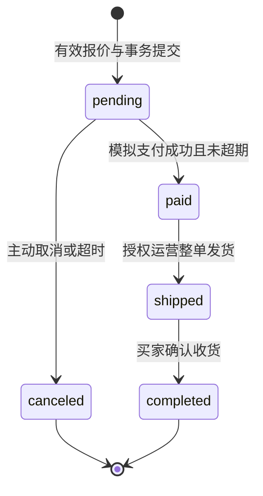

# 业务规则、状态机与数据模型

版本 v1.0｜2026-11-06｜实现目标，待人工审核；无数据库迁移。

## 1. 业务规则目录

以下默认值是本项目的产品决策，不是平台要求。修改时必须同步接口、界面、测试与配置；已成立订单继续使用快照。

| 规则ID | 定稿建议 | 必须验证的边界 |
| --- | --- | --- |
| R01 身份 | auth.User + Profile；手机号未绑定可为空，已验证手机号唯一；外部身份唯一绑定一个内部用户 | 不按昵称合并；绑定验证已有账号；停用立即拒绝会话；浏览不强制电话授权 |
| R02 地址 | 每人最多20条；锁用户行维护唯一默认；删除默认时选剩余最近更新的一条，时间相同取最大ID，无剩余则无默认 | 并发新增不能21条；并发设置仅一个默认；订单地址快照不变 |
| R03 SKU/库存 | 商品draft/on_sale/off_sale；价格≥0；每SKU可售库存≥0；加购不占库存 | 商品与SKU均可售才可买；下架不妨碍历史订单履约；库存调整必须原因/流水 |
| R04 购物车 | user+sku唯一，每项1–99，最多50种SKU；游客只存SKU/数量等非敏感选择 | 合并数量超过99返回差异供确认；不静默删掉缺货/下架项；合并重试不重复累加 |
| R05 金额/配送 | CNY；单价/总额Decimal(12,2)，JSON两位字符串；V1仅中国大陆地址，单订单统一配送 | 演示默认运费8.00，商品原价合计≥129.00免运费，优惠不改变免运门槛；规则配置化且留版本；超出地区不接单 |
| R06 试算/提交 | 报价有效5分钟；不锁库存/券；下单重算并核对商品商业版本、配送、地址及券规则 | 值或履约内容变化必须重报价并确认；库存不足直接阻断；客户端不提交可信合计 |
| R07 下单 | 每订单≤50种SKU、每种≤99；同SKU输入拒绝重复项；商品/地址/金额快照；待支付30分钟 | 以服务器时间为准；达到expires_at不得再支付，即便关单worker尚未执行 |
| R08 幂等 | 下单/加购累加/合并/领券/模拟支付/消息等变更使用幂等；同键同参重放，同键异参409 | 请求ID不替代幂等键；同一购买intent_id在同一用户下永久唯一，缓存过期也不重复建单 |
| R09 支付与履约 | 仅模拟；同订单一个成功支付；一次整单发货；买家主动收货，无自动收货 | 失败支付可另建尝试；paid不支持取消/退款入口；前端回调不能更改订单结果 |
| R10 券 | 每单最多1张，不叠加；满减或百分比折扣；只折商品金额，不抵运费 | 门槛按适用商品优惠前合计；折扣≤适用金额；库存与限领由DB保证 |
| R11 券生命周期 | 模板draft→active→stopped；经济条款发布后不可改；stopped仅停新领 | 已领按快照有效；unused过期不可用；有效期内下单占用后可在该订单付款期限内核销 |
| R12 取消 | 仅pending可主动/超时取消；一次释放库存、券；支付与取消竞争锁同一订单 | reserved券释放时若已超有效期转expired，否则unused；重复关单不多补库存 |
| R13 评价 | 本人已完成订单项，一项一评；星1–5，去空白后1–500字；V1提交后不编辑 | pending→approved/rejected；approved→hidden；仅approved公开并计入评分，不能因低分自动拒审 |
| R14 消息 | 站内通知为可靠兜底，平台订阅可选；订单事件经Outbox去重投递 | 全部已读仅处理请求水位之前消息；并发新消息仍未读；未读从事实数据可重建 |
| R15 CMS | 草稿版本与已发布版本隔离；审核发布内容块，公开仅取生效版本 | 发布时段[start,end)，草稿不泄漏；内容更新后仍显示上一已发布版本直到再次发布 |
| R16 客服 | 每用户最多一个活动会话；open→closed；仅分配客服/授权主管操作 | 关闭会话不可发送，重开新ID；client_message_id去重；“已读”必须来自明确读水位 |
| R17 审计/并发编辑 | 运营修改含expected_version；冲突不覆盖别人修改；审计与业务写入同事务 | 价格/库存/发布/发货/授权/审核记录前后差异、原因与操作者，敏感字段脱敏 |

注册基线为商城用户名+密码；已验证手机号也可作为密码登录标识；手机绑定/找回通过独立一次性验证挑战，开发演示适配必须明确标识且生产不可启用。小程序平台登录可建立未绑手机的内部账户；手机号并非必须填写的Profile字段。密码找回仅适用于已有验证渠道，未绑定渠道显示可行的人工核验入口，不伪造“已发送短信”。短信供应商与真实投递列入实施前核验。

## 2. 金额算法与示例

金额计算全部在后端十进制域完成。`goods_amount = Σ(unit_price × quantity)`；`payable_amount = goods_amount + freight_amount - discount_amount`。每项行金额和订单金额都检查Decimal(12,2)上限，溢出400；不能等数据库截断。数量使用整数。显示小数两位，不用浮点数生成支付值。

满减：适用商品合计达到threshold_amount后，优惠为min(reduction_amount, 适用商品合计)。百分比券使用`discount_bps`表示减免比例，1–10000基点，例如1000代表减免10%；优惠=适用金额×比例，ROUND_HALF_UP至分，再按cap_amount和适用金额封顶。百分比券cap_amount必填；满减券不同时设置discount_bps。有效时间均[start_at,end_at)。

分摊先将优惠转整数分，按各适用订单项金额比例向下取整，剩余分按小数余数降序分配，余数相同按SKU ID升序。零金额项不分摊；行优惠不超过行金额；行优惠之和必须等于订单优惠。快照保存分摊结果，为后续售后设计留证，不代表V1已有退款。

| 示例 | 商品 | 运费 | 券优惠 | 应付 |
| --- | --- | --- | --- | --- |
| 单杯 | 99.00×1 | 8.00 | 无 | 107.00 |
| 达免运门槛 | 129.00×1 | 0.00 | 满129减20→20.00 | 109.00 |
| 两项分摊 | 99.00+69.00 | 0.00 | 20.00，分摊11.79/8.21 | 148.00 |
| 百分比封顶 | 300.00 | 0.00 | 10%优惠，封顶20→20.00 | 280.00 |

不自动换成另一张券。可推荐最大优惠，但由用户选择；已选券失效返回原因和新试算入口。应付0也经明确的演示确认动作流转paid，不静默完成订单。

## 3. 订单与事务设计

统一锁顺序：命令幂等记录→已有订单行（适用时）→SKU按ID升序→用户券按ID升序；库存调整只锁SKU，不反向锁订单。新订单尚无订单行，以幂等/intent唯一约束协调，再锁SKU和券。领券使用模板→用户限领计数固定顺序；其他路径不反向获取这些锁。跨业务锁顺序改变须有MariaDB死锁/回滚测试。

下单事务：验证本人地址与quote归属→核验/登记intent→锁SKU并重算→锁券验证→条件扣可售库存→占券→写订单/明细/地址/费用快照→库存流水→Outbox→幂等完成。任一步失败全部回滚。报价查询本身不预扣库存。比较商品商业字段快照，不把库存数的正常变化当成价格变化；库存只判断当前是否足够。地址快照取一次一致读取的已确认版本；并发修改后要么形成原确认快照，要么冲突重确认，不能拼成新旧混合地址。

模拟支付事务：锁订单→检查pending且当前时间<expires_at→校验支付尝试与订单金额→锁券核销→支付success、订单paid、写Outbox。失败只结束本次支付尝试，不把订单改成“失败”。发货/收货各自以订单状态条件更新并记事件，不能通过通用PATCH任意改状态。

取消事务：锁订单→仅pending允许→锁SKU恢复可售数→锁券释放→库存释放流水唯一→订单canceled→Outbox。库存概念在V1为“可售”和“待支付预占”；付款消耗预占但不再次扣可售。实仓盘点/WMS不在V1，后台不得把演示可售数声称为实盘仓存。

订单下单成功但响应丢失：客户端保留同一intent_id及Idempotency-Key，先查操作状态；已完成取原order_no，处理中按Retry-After等待，未找到仍使用原键重试。7天后短期响应记录可清理，持久intent与订单唯一绑定仍保证不会生成第二单；取消后再次购买必须创建新intent。

## 4. 数据字典约定

下列是逻辑表设计，表名为建议，具体Django迁移需验证MariaDB。新业务主键BigAutoField，API所有ID为字符串；现有auth表主键保持现状，不为统一类型强迁移。通用created_at/updated_at为aware UTC；不可变流水仅created_at即可，不机械继承带is_deleted的BaseModel。业务实体历史引用用PROTECT或明确保留策略。

字符串默认非空，真正可选唯一值用NULL而非空串；时间API带时区。业务状态枚举限制写入；version正整数初始1，用于乐观并发控制。JSON只放快照/内容块/事件载荷，不代替可索引关联与唯一约束。所有下表字段均为目标，不代表迁移存在。

### 4.1 身份与资料

| 表 | 关键字段 | 约束与索引 |
| --- | --- | --- |
| accounts_profile | user_id；nickname varchar(50)；phone varchar(20) NULL；phone_verified_at NULL；avatar_media_id NULL；session_version int | user_id一对一；phone唯一且NULL允许未绑定；公开资料不返回电话 |
| accounts_external_identity | user_id；provider varchar(20)；appid varchar(128)；subject varchar(128)；bound_at | UNIQUE(provider,appid,subject)，标识使用区分大小写语义；不按昵称绑定；不向客户端暴露平台密钥 |
| accounts_session | user_id；session_id UUID；client_kind web/mini；refresh_digest；expires_at/revoked_at；version | session_id唯一；只存refresh摘要/不可逆标识；索引(user_id,revoked_at)；每次业务认证检查撤销和账号状态 |
| accounts_verification | challenge_id UUID；purpose；target_digest；code_digest；attempts；expires_at；consumed_at | 挑战一次性，验证码不明文存储；用途隔离、限尝试；不记日志 |
| users_address | user_id；recipient varchar(50)；phone varchar(20)；province/city/district varchar(50)；region_code varchar(12)；detail varchar(200)；is_default；version | 索引(user_id,is_default)；锁user保证条数和默认唯一；不依赖部分唯一索引 |

地区码来自版本化地区数据，省市区名称与代码由后端核对，不能仅靠前端下拉；直辖市等合法情况按数据集处理，数据集来源与更新策略在I03登记。

### 4.2 商品、购物车与报价

| 表 | 关键字段 | 约束与索引 |
| --- | --- | --- |
| catalog_category | parent_id NULL；name varchar(50)；sort_order；enabled；version | 防循环/非法父级；索引(parent_id,sort_order,id) |
| catalog_product | category_id；title varchar(120)；subtitle varchar(200)；status；description_blocks JSON；version | 索引(status,category_id,id)；公开查询排除草稿/下架 |
| catalog_sku | product_id；sku_code varchar(64)；spec_values JSON；spec_fingerprint varchar(64)；price decimal(12,2)；available_stock int；enabled；version | sku_code唯一；UNIQUE(product_id,spec_fingerprint)；price/stock CHECK≥0；扣库存条件更新 |
| media_asset / catalog_product_media | 存储key、MIME、size、width/height、状态；product_id、media_id、sort_order | 真实解码/重编码；V1仅JPEG/PNG/WebP，≤5MB且≤2000万像素；不接受SVG/可执行文件；发布只引用ready资源 |
| cart_item | user_id；sku_id；quantity int；selected；version | UNIQUE(user_id,sku_id)，数量1–99；商品价格只读取当前值不作结算凭据 |
| checkout_quote | quote_id UUID；user_id；items JSON；address_id/version；coupon_id NULL；rule_versions JSON；amounts JSON；expires_at | quote_id唯一；5分钟；只存必要报价快照，完整地址在订单成立时固化；不承担库存占用 |
| shipping_rule | version；base_amount；free_threshold；allowed_regions JSON；active_at | 已用版本不可改，创建新版本生效；订单保存命中规则与金额 |

库存流水`inventory_ledger`：sku_id、order_id NULL、kind(reserve/release/adjust)、quantity_delta、business_ref、actor_id、reason、created_at；UNIQUE(sku_id,kind,business_ref)。reserve为负、release为正；人工调整使用独立业务号，禁止直接覆盖字段绕过流水。

### 4.3 订单与支付

| 表 | 关键字段 | 约束与索引 |
| --- | --- | --- |
| order_purchase_intent | user_id；intent_id UUID；request_digest；order_id NULL；outcome | UNIQUE(user_id,intent_id)，永久业务去重；只有完整提交成功才关联订单，失败可按同参数重试 |
| order_order | order_no varchar(32)；user_id；status；currency char(3)；goods/freight/discount/payable_amount decimal(12,2)；expires_at；paid/shipped/completed/canceled_at NULL；version | order_no唯一；金额关系CHECK；索引(user_id,created_at,id)、(status,expires_at,id)；不支持物理删除 |
| order_order_item | order_id；sku_id；product_title/sku_code/spec快照；unit_price；quantity；line_amount；discount_allocated；image快照 | UNIQUE(order_id,sku_id)；正数量；行金额公式；外部主数据变化不重算 |
| order_address_snapshot | order_id；recipient/phone/地区/详细地址快照 | order_id一对一；与订单同权限，日志不打印，后台列表脱敏 |
| order_discount_snapshot | order_id；user_coupon_id；template_version；type/threshold/rate/cap/减免/适用范围快照 | V1每订单最多一条；为分摊与审计留存，不能引用动态模板来展示历史规则 |
| payment_attempt | pay_no varchar(32)；order_id；status init/success/failed；amount；mode demo；failure_reason NULL | pay_no唯一；索引(order_id,created_at,id)；成功写入payment_success |
| payment_success | order_id；attempt_id；amount；succeeded_at | order_id唯一，attempt_id唯一；永久约束同订单最多一笔成功 |
| order_shipment | order_id；carrier varchar(50)；tracking_no varchar(100)；operator_id；shipped_at | order_id唯一，整单单次发货；物流单号不声明全球唯一；演示标识 |
| order_event | order_id；type；from/to_status；actor_id NULL；business_ref；created_at | UNIQUE(order_id,type,business_ref)；索引(order_id,created_at,id)；时间线不可编辑 |

### 4.4 优惠券、内容与沟通

| 表 | 关键字段 | 约束与索引 |
| --- | --- | --- |
| promotion_template | name；type fixed/percentage；threshold_amount；reduction_amount NULL；discount_bps NULL；cap_amount NULL；scope all/products；start/end_at；claim_start/end_at；total/issued int；per_user_limit；status；version | issued≤total且≥0；领用窗口须落在使用有效窗口内；发布后经济条款冻结，停领单独动作 |
| promotion_scope | template_id；product_id | UNIQUE(template_id,product_id)；all不存明细；products至少一项 |
| promotion_user_counter | user_id；template_id；claimed_count | UNIQUE(user_id,template_id)；事务锁定、限领条件更新；允许per_user_limit>1 |
| promotion_user_coupon | user_id；template_id；serial_no；terms_snapshot；status；reserved_order_id NULL；used_order_id NULL；reserved/used_at NULL | serial_no唯一；索引(user_id,status,end_at,id)；有效end_at冗余为可索引字段；券行锁保证不可被两单占用 |
| review_review | order_item_id；user_id；product_id；rating；content varchar(500)；status；moderation_reason；moderated_by/at NULL | order_item_id唯一；rating 1–5；索引(product_id,status,created_at,id)；原文不可被审核员改写 |
| notification_notice | user_id；recipient_seq bigint；event_id；type；title varchar(100)；body varchar(1000)；target_type/target_id；read_at NULL | UNIQUE(user_id,event_id,type)、UNIQUE(user_id,recipient_seq)；索引(user_id,read_at,recipient_seq)；不嵌完整地址 |
| notification_sequence | user_id；last_seq bigint | user_id唯一；发送同用户通知先锁计数行，再分配seq并插入，同事务提交；全读水位只含已提交seq |
| notification_template | event_type；channel；variables JSON；content；version；enabled | UNIQUE(event_type,channel,version)；启用模板指针唯一；参数白名单 |
| notification_subscription | user_id；provider/appid；template_key；result；recorded_at；delivery_reference NULL | 记录一次能力申请结果，不把accept当永久授权；实际发送另记状态/失败原因 |
| cms_content / cms_revision | content_id、slug、kind、published_revision_id；revision_no、blocks JSON、start/end_at、status、editor_id | slug唯一；UNIQUE(content_id,revision_no)；草稿不可公共读取；内容块为跨端受限schema |
| support_conversation | user_id；assigned_agent_id NULL；status；last_message_seq bigint；closed_at NULL；version | 索引(assigned_agent_id,status,updated_at,id)；分配用version防覆盖 |
| support_active_conversation | user_id；conversation_id | user_id唯一，conversation_id唯一；创建/关闭与映射同事务，不靠部分索引 |
| support_message | conversation_id；conversation_seq bigint；sender_id；client_message_id UUID；body varchar(2000)；created_at | UNIQUE(conversation_id,sender_id,client_message_id)、UNIQUE(conversation_id,conversation_seq)；先锁会话再分配序号并插入，同事务提交；纯文本 |
| support_read_cursor | conversation_id；reader_id；last_seq；last_message_id | UNIQUE(conversation_id,reader_id)；水位只前进；读水位必须属于该会话 |

### 4.5 基础可靠性

`common_idempotency`：actor_id、operation、key varchar(64)、request_digest、status processing/succeeded、resource_type/id、response_snapshot、created_at/expires_at；UNIQUE(actor_id,operation,key)。规范化摘要含路径对象和业务参数，不含request_id、当前access或client_type。短期结果只保留非敏感响应；失败回滚后无成功记录。处理中通过有时限租约/事务恢复，不能永久占坑。

`common_outbox`：event_id UUID唯一、aggregate_type/id、event_type、schema_version、payload、occurred_at、next_attempt_at、attempts、lease_until、status；索引(status,next_attempt_at,id)。`common_consumption`：event_id、consumer、processed_at，联合唯一。消费者业务写入与去重标记同事务；先标成功再执行会丢消息，不允许。

`audit_log`：actor_id、action、object_type/id、redacted_before/after JSON、reason、request_id、created_at；索引(object_type,object_id,created_at,id)。追加式，不提供业务编辑/删除API。手机号、地址只记字段名或脱敏差异，凭据完全不入审计。

业务数据留存、脱敏和清理应按实体列策略；不得凭通用is_deleted让订单/审计消失。正式商业留存期限需由运营与合规确认，本稿不杜撰法定年限。

## 5. 查询与迁移要求

商品列表避免N+1，分类和状态筛选、排序白名单；用户列表查询先带user_id。通知/聊天使用(recipient_seq,id)/(conversation_seq,id)稳定游标，时间用于展示；序号在各自收件人/会话锁内分配直至提交，避免仅靠时间戳或自增ID导致晚提交消息漏读。全读只处理水位以内，后提交消息取更大序号。其他只读历史时间线可用(created_at,id)。索引须在目标MariaDB数据集EXPLAIN验证，不能以SQLite执行计划代替。

模型实施顺序：身份→资料→商品→购物车/报价→订单/流水/Outbox→券→评价→通知→CMS→客服。先加可空字段和索引、分批回填、验证再收紧约束；每个迁移说明旧版本读取兼容性和恢复方案。跨库兼容需实际验证，不依赖MariaDB不支持的部分唯一索引。未经明确授权不清库、不删除迁移、不迁移真实用户数据来“重置环境”。

## I07 数据模型落地说明（2026-11-09）

发行总量由模板行锁与 issued < total 条件更新保证；单用户限领通过锁内统计券实例及 UNIQUE(template,user,claim_index) 保证，未另设可独立漂移的用户计数表。草稿版本、发布、停领均保留模板修订快照及操作者，发布/停领原因随幂等回执保存。每张券保留领取时条款，活动订单以唯一订单外键关联。订单中的 coupon_snapshot 及订单项 discount_allocated 冻结实际使用的规则和分摊；释放后仍可从历史订单回溯。

## I09–I10 数据模型落地说明（2026-11-09）

通知实际使用 `notifications_notification`、`notifications_notificationsequence`、`notifications_notificationconsumption`、`notifications_notificationtemplate` 及启用指针表。订单事件、评价审核动作、公告事件和后续客服事件共用UUID事件标识，但各消费者独立记录回执；订单履约动态字段不能作为通知已读或已投递依据。序号在收件人用户锁和序号行锁内分配，已读水位只作用于已提交序号。

CMS 实际使用 `content_content`、`content_contentrevision`、`content_contentaction` 与 `content_contentevent`。内容行保存稳定 slug、版本、发布状态和已发布revision指针；revision保存标题、跨端内容块、平台、排序、起止时间及公告通知开关。草稿新增revision不改变指针，发布/下线与操作审计、幂等回执在同一事务完成。公开查询重新校验时段和平台，首页缓存最长60秒且发布/下线提交后失效；商品推荐不作为缓存中的可售事实，每次聚合重新查询。

`notify_inbox` 只允许公告使用，事件与公告revision一对一，防止同版本重复发布造成重复广播。通知只表示站内兜底，不派生微信永久授权或送达状态。`content.0001` 的无表 `ContentAccess` 仅承载 `content.publish` 权限，不保存业务内容；实际内容表从 `content.0002` 开始。

## I11 客服数据模型落地说明（2026-11-09）

`support_conversation` 保存买家、可选关联订单、分配客服、状态、版本和最后消息序号；`support_activeconversation` 分别以 user_id 和 conversation_id 唯一，创建/关闭与活动映射同事务，不使用部分唯一索引。`support_supportmessage` 以 `(conversation_id,sender_id,client_message_id)` 和 `(conversation_id,conversation_seq,id)` 唯一约束保证重试与稳定游标，正文为纯文本，通知事件UUID独立唯一。

`support_readcursor` 以会话和读者唯一，水位只在目标消息属于该会话且序号更大时前进。`support_supportcommand` 保存创建、分配、关闭的永久幂等回执。客服回复事件由扫描器独立消费，不复制聊天正文到站内通知，不将发送成功或页面打开推断为对方在线/已读。关联订单只输出必要摘要，不输出收货快照。
