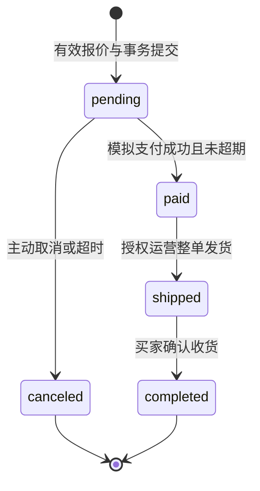

# 业务规则、状态机与数据模型

业务基线 `17f5b91`，2026-11-09。R 编号用于需求和验收追溯，第 4 节按在库 Django 模型列出实际字段。

## 1. 业务规则目录

以下默认值是本项目的产品决策，不是平台要求。修改时必须同步接口、界面、测试与配置；已成立订单继续使用快照。

| 规则ID | 定稿建议 | 必须验证的边界 |
| --- | --- | --- |
| R01 身份 | auth.User + Profile；手机号未绑定可为空，已验证手机号唯一；微信身份绑定为后续接入要求 | 不按昵称合并；绑定验证已有账号；停用立即拒绝会话；浏览不强制电话授权 |
| R02 地址 | 每人最多20条；锁用户行维护唯一默认；删除默认时选剩余最近更新的一条，时间相同取最大ID，无剩余则无默认 | 并发新增不能21条；并发设置仅一个默认；订单地址快照不变 |
| R03 SKU/库存 | 商品draft/on_sale/off_sale；价格≥0；每SKU可售库存≥0；加购不占库存 | 商品与SKU均可售才可买；下架不妨碍历史订单履约；库存调整必须原因/流水 |
| R04 购物车 | user+sku唯一，每项1–99，最多50种SKU；游客只存SKU/数量等非敏感选择 | 合并数量超过99返回差异供确认；不静默删掉缺货/下架项；合并重试不重复累加 |
| R05 金额/配送 | CNY；单价/总额Decimal(12,2)，JSON两位字符串；V1仅中国大陆地址，单订单统一配送 | 演示默认运费8.00，商品原价合计≥129.00免运费，优惠不改变免运门槛；规则配置化且留版本；超出地区不接单 |
| R06 试算/提交 | 报价有效5分钟；不锁库存/券；下单重算并核对商品商业版本、配送、地址及券规则 | 值或履约内容变化必须重报价并确认；库存不足直接阻断；客户端不提交可信合计 |
| R07 下单 | 每订单≤50种SKU、每种≤99；同SKU输入拒绝重复项；商品/地址/金额快照；待支付30分钟 | 以服务器时间为准；达到expires_at不得再支付，即便关单worker尚未执行 |
| R08 幂等 | 下单/加购累加/合并/领券/模拟支付/消息等变更使用幂等；同键同参重放，同键异参409 | 请求ID不替代幂等键；同一购买intent_id在同一用户下永久唯一，缓存过期也不重复建单 |
| R09 支付与履约 | 仅模拟；同订单一个成功支付；一次整单发货；买家主动收货，无自动收货 | 失败支付可另建尝试；paid不支持取消/退款入口；前端回调不能更改订单结果 |
| R10 券 | 每单最多1张，不叠加；满减或百分比折扣；只折商品金额，不抵运费 | 门槛按适用商品优惠前合计；折扣≤适用金额；库存与限领由DB保证 |
| R11 券生命周期 | 模板draft→active→stopped；经济条款发布后不可改；stopped仅停新领 | 已领按快照有效；unused过期不可用；有效期内下单占用后可在该订单付款期限内核销 |
| R12 取消 | 仅pending可主动/超时取消；一次释放库存、券；支付与取消竞争锁同一订单 | reserved券释放时若已超有效期转expired，否则unused；重复关单不多补库存 |
| R13 评价 | 本人已完成订单项，一项一评；星1–5，去空白后1–500字；V1提交后不编辑 | pending→approved/rejected；approved→hidden；仅approved公开并计入评分，不能因低分自动拒审 |
| R14 消息 | 站内通知为可靠兜底，平台订阅可选；订单事件经Outbox去重投递 | 全部已读仅处理请求水位之前消息；并发新消息仍未读；未读从事实数据可重建 |
| R15 CMS | 草稿版本与已发布版本隔离；审核发布内容块，公开仅取生效版本 | 发布时段[start,end)，草稿不泄漏；内容更新后仍显示上一已发布版本直到再次发布 |
| R16 客服 | 每用户最多一个活动会话；open→closed；仅分配客服/授权主管操作 | 关闭会话不可发送，重开新ID；client_message_id去重；“已读”必须来自明确读水位 |
| R17 审计/并发编辑 | 运营修改含expected_version；冲突不覆盖别人修改；审计与业务写入同事务 | 价格/库存/发布/发货/授权/审核记录前后差异、原因与操作者，敏感字段脱敏 |

注册基线为商城用户名+密码；已验证手机号也可作为密码登录标识；手机绑定/找回通过独立一次性验证挑战，开发演示适配必须明确标识且生产不可启用。当前小程序使用商城账号登录，微信换证与绑定待接入；手机号并非必须填写的Profile字段。密码找回仅适用于已有验证渠道，未绑定渠道显示可行的人工核验入口，不伪造“已发送短信”。短信供应商与真实投递列入实施前核验。

## 2. 金额算法与示例

金额计算全部在后端十进制域完成。`goods_amount = Σ(unit_price × quantity)`；`payable_amount = goods_amount + freight_amount - discount_amount`。每项行金额和订单金额都检查Decimal(12,2)上限，溢出400；不能等数据库截断。数量使用整数。显示小数两位，不用浮点数生成支付值。

满减：适用商品合计达到threshold_amount后，优惠为min(reduction_amount, 适用商品合计)。百分比券使用`discount_bps`表示减免比例，1–10000基点，例如1000代表减免10%；优惠=适用金额×比例，ROUND_HALF_UP至分，再按cap_amount和适用金额封顶。百分比券cap_amount必填；满减券不同时设置discount_bps。有效时间均[start_at,end_at)。

分摊先将优惠转整数分，按各适用订单项金额比例向下取整，剩余分按小数余数降序分配，余数相同按SKU ID升序。零金额项不分摊；行优惠不超过行金额；行优惠之和必须等于订单优惠。快照保存分摊结果，为后续售后设计留证，不代表V1已有退款。

| 示例 | 商品 | 运费 | 券优惠 | 应付 |
| --- | --- | --- | --- | --- |
| 单杯 | 99.00×1 | 8.00 | 无 | 107.00 |
| 达免运门槛 | 129.00×1 | 0.00 | 满129减20→20.00 | 109.00 |
| 两项分摊 | 99.00+69.00 | 0.00 | 20.00，分摊11.79/8.21 | 148.00 |
| 百分比封顶 | 300.00 | 0.00 | 10%优惠，封顶20→20.00 | 280.00 |

不自动换成另一张券。可推荐最大优惠，但由用户选择；已选券失效返回原因和新试算入口。应付0也经明确的演示确认动作流转paid，不静默完成订单。

## 3. 订单与事务设计

订单命令先锁操作者，再查询已有幂等回执。下单先按主键锁定商品，再按 SKU ID 顺序取锁；已有订单的支付和关单锁定同一订单，之后更新库存与券。领取优惠券时锁模板并在事务内检查发行量及该用户已领数量。跨业务锁顺序改变须有MariaDB死锁/回滚测试。

下单事务：验证本人地址与quote归属→核验/登记intent→锁SKU并重算→锁券验证→条件扣可售库存→占券→写订单/明细/地址/费用快照→库存流水→Outbox→幂等完成。任一步失败全部回滚。报价查询本身不预扣库存。比较商品商业字段快照，不把库存数的正常变化当成价格变化；库存只判断当前是否足够。地址快照取一次一致读取的已确认版本；并发修改后要么形成原确认快照，要么冲突重确认，不能拼成新旧混合地址。

模拟支付事务：锁订单→检查pending且当前时间<expires_at→校验支付尝试与订单金额→锁券核销→支付success、订单paid、写Outbox。失败只结束本次支付尝试，不把订单改成“失败”。发货/收货各自以订单状态条件更新并记事件，不能通过通用PATCH任意改状态。

取消事务：锁订单→仅pending允许→锁SKU恢复可售数→锁券释放→库存释放流水唯一→订单canceled→Outbox。库存概念在V1为“可售”和“待支付预占”；付款消耗预占但不再次扣可售。实仓盘点/WMS不在V1，后台不得把演示可售数声称为实盘仓存。

订单下单成功但响应丢失：客户端保留同一intent_id及Idempotency-Key，先查操作状态；已完成取原order_no，处理中按Retry-After等待，未找到仍使用原键重试。保留策略要求短期回执至少保存 7 天；购买意图和订单的持久唯一约束独立生效；取消后再次购买必须创建新intent。

## 4. 数据字典与持久化边界

表内列出模型直接声明的字段。Django 隐式主键和反向关系省略；外键使用模型属性名，实际列通常带 `_id`。物理列类型、外键删除策略、索引和唯一约束以各应用 migrations 为准。金额使用 Decimal，业务号和购买意图使用 UUID，前端保留 JSON 返回的标识格式。

订单四项金额存独立十进制列，地址、券和发货信息存订单 JSON 快照，商品明细另表保存。报价与订单一对一，账号与购买意图联合唯一。支付成功事实由 Settlement 的两个一对一关系约束。商品人工调库存写 StockAdjustment，订单预占、消耗与释放写 StockMovement。两者分别记录操作者原因与业务流水。

### accounts

[模型定义](../backend/accounts/models.py)

| 模型 | 持久化字段（Django 属性名） |
| --- | --- |
| `Profile` | `user`, `phone`, `phone_verified_at`, `nickname`, `session_version`, `created_at`, `updated_at` |
| `AuthSession` | `session_id`, `user`, `client_kind`, `refresh_digest`, `csrf_digest`, `expires_at`, `revoked_at`, `created_at`, `updated_at` |
| `VerificationChallenge` | `challenge_id`, `user`, `purpose`, `target_digest`, `code_digest`, `attempts`, `expires_at`, `consumed_at`, `created_at` |
| `RoleAction` | `actor`, `target`, `action`, `key`, `digest`, `reason`, `snapshot`, `result`, `created_at` |

### users

[模型定义](../backend/users/models.py)

| 模型 | 持久化字段（Django 属性名） |
| --- | --- |
| `Address` | `user`, `recipient`, `phone`, `province`, `city`, `district`, `region_code`, `detail`, `is_default`, `version`, `created_at`, `updated_at` |

### catalog

[模型定义](../backend/catalog/models.py)

| 模型 | 持久化字段（Django 属性名） |
| --- | --- |
| `Category` | `name`, `parent`, `sort_order`, `enabled`, `version` |
| `CategoryEvent` | `category`, `actor`, `action`, `snapshot`, `created_at` |
| `MediaAsset` | `file`, `width`, `height`, `uploaded_by`, `created_at` |
| `Product` | `category`, `cover`, `title`, `description`, `status`, `version`, `min_price` |
| `Sku` | `version`, `product`, `label`, `price`, `available_stock`, `reserved_stock` |
| `CatalogEvent` | `product`, `actor`, `action`, `snapshot`, `created_at` |
| `StockAdjustment` | `sku`, `actor`, `operator`, `key`, `expected_version`, `delta`, `reason`, `before`, `after`, `created_at` |

### cart

[模型定义](../backend/cart/models.py)

| 模型 | 持久化字段（Django 属性名） |
| --- | --- |
| `Cart` | `user`, `version` |
| `CartItem` | `cart`, `sku`, `quantity`, `selected`, `version` |
| `CartOperation` | `cart`, `operation`, `key`, `inputs`, `result`, `created_at` |
| `Quote` | `id`, `user`, `snapshot`, `created_at`, `expires_at` |

### orders

[模型定义](../backend/orders/models.py)

| 模型 | 持久化字段（Django 属性名） |
| --- | --- |
| `Order` | `order_no`, `user`, `quote`, `intent_id`, `coupon_snapshot`, `address_snapshot`, `goods_amount`, `freight_amount`, `discount_amount`, `payable_amount`, `currency`, `status`, `expires_at`, `created_at`, `version`, `shipment` |
| `OrderItem` | `order`, `sku`, `snapshot`, `quantity` |
| `StockMovement` | `item`, `kind`, `available_delta`, `reserved_delta` |
| `Payment` | `pay_no`, `order`, `status`, `amount`, `created_at` |
| `Settlement` | `order`, `payment`, `created_at` |
| `Event` | `event_id`, `order`, `kind`, `reason`, `actor`, `occurred_at`, `delivered_at` |
| `OrderActivity` | `event`, `received_at` |
| `Operation` | `user`, `operation`, `key`, `digest`, `order`, `resource_id`, `result` |

### promotions

[模型定义](../backend/promotions/models.py)

| 模型 | 持久化字段（Django 属性名） |
| --- | --- |
| `Template` | `name`, `type`, `threshold_amount`, `reduction_amount`, `discount_bps`, `cap_amount`, `scope`, `products`, `start_at`, `end_at`, `claim_start_at`, `claim_end_at`, `total`, `issued`, `per_user_limit`, `status`, `version` |
| `Coupon` | `user`, `template`, `serial_no`, `claim_index`, `terms`, `start_at`, `end_at`, `status`, `order`, `reserved_at`, `used_at` |
| `Receipt` | `actor`, `operation`, `key`, `template`, `inputs`, `result`, `created_at` |
| `Revision` | `template`, `version`, `actor`, `action`, `snapshot`, `created_at` |

### reviews

[模型定义](../backend/reviews/models.py)

| 模型 | 持久化字段（Django 属性名） |
| --- | --- |
| `Review` | `order_item`, `product`, `user`, `rating`, `content`, `status`, `version`, `moderation_reason`, `moderated_by`, `moderated_at`, `created_at` |
| `ReviewAction` | `event_id`, `actor`, `operation`, `key`, `digest`, `review`, `from_status`, `to_status`, `reason`, `version`, `created_at` |

### content

[模型定义](../backend/content/models.py)

| 模型 | 持久化字段（Django 属性名） |
| --- | --- |
| `Content` | `kind`, `slug`, `status`, `published_revision`, `version`, `created_at`, `updated_at` |
| `ContentRevision` | `content`, `revision_no`, `title`, `blocks`, `platforms`, `sort_order`, `start_at`, `end_at`, `notify_inbox`, `editor`, `created_at` |
| `ContentEvent` | `event_id`, `revision`, `kind`, `occurred_at` |
| `ContentAction` | `actor`, `content`, `revision`, `operation`, `key`, `digest`, `reason`, `snapshot`, `result`, `created_at` |

### notifications

[模型定义](../backend/notifications/models.py)

| 模型 | 持久化字段（Django 属性名） |
| --- | --- |
| `NotificationTemplate` | `event_type`, `channel`, `version`, `title`, `body`, `variables`, `enabled`, `editor`, `created_at` |
| `NotificationTemplatePointer` | `event_type`, `channel`, `template` |
| `NotificationTemplateAction` | `actor`, `operation`, `key`, `digest`, `template`, `result`, `created_at` |
| `NotificationSequence` | `user`, `last_seq` |
| `Notification` | `user`, `recipient_seq`, `event_id`, `type`, `title`, `body`, `target_type`, `target_id`, `read_at`, `created_at` |
| `NotificationConsumption` | `event_id`, `consumer`, `processed_at` |
| `NotificationSubscription` | `user`, `provider`, `template_key`, `result`, `client_event_id`, `request_digest`, `delivery_reference`, `recorded_at` |

### support

[模型定义](../backend/support/models.py)

| 模型 | 持久化字段（Django 属性名） |
| --- | --- |
| `Conversation` | `user`, `assigned_agent`, `order`, `status`, `last_message_seq`, `version`, `created_at`, `updated_at`, `closed_at`, `close_reason` |
| `ActiveConversation` | `user`, `conversation` |
| `SupportMessage` | `notification_event_id`, `conversation`, `conversation_seq`, `sender`, `sender_role`, `client_message_id`, `body`, `created_at` |
| `ReadCursor` | `conversation`, `reader`, `last_seq`, `last_message` |
| `SupportCommand` | `actor`, `operation`, `key`, `digest`, `conversation`, `result`, `created_at` |

## 5. 查询与迁移要求

商品列表避免N+1，分类和状态筛选、排序白名单；用户列表查询先带user_id。通知/聊天使用(recipient_seq,id)/(conversation_seq,id)稳定游标，时间用于展示；序号在各自收件人/会话锁内分配直至提交，避免仅靠时间戳或自增ID导致晚提交消息漏读。全读只处理水位以内，后提交消息取更大序号。其他只读历史时间线可用(created_at,id)。索引须在目标MariaDB数据集EXPLAIN验证，不能以SQLite执行计划代替。

模型实施顺序：身份→资料→商品→购物车/报价→订单/流水/Outbox→券→评价→通知→CMS→客服。先加可空字段和索引、分批回填、验证再收紧约束；每个迁移说明旧版本读取兼容性和恢复方案。跨库兼容需实际验证，不依赖MariaDB不支持的部分唯一索引。未经明确授权不清库、不删除迁移、不迁移真实用户数据来“重置环境”。

## I07 数据模型落地说明（2026-11-09）

发行总量由模板行锁与 issued < total 条件更新保证；单用户限领通过锁内统计券实例及 UNIQUE(template,user,claim_index) 保证，未另设可独立漂移的用户计数表。草稿版本、发布、停领均保留模板修订快照及操作者，发布/停领原因随幂等回执保存。每张券保留领取时条款，活动订单以唯一订单外键关联。订单中的 coupon_snapshot 及订单项 discount_allocated 冻结实际使用的规则和分摊；释放后仍可从历史订单回溯。

## I09–I10 数据模型落地说明（2026-11-09）

通知实际使用 `notifications_notification`、`notifications_notificationsequence`、`notifications_notificationconsumption`、`notifications_notificationtemplate` 及启用指针表。订单事件、评价审核动作、公告事件和后续客服事件共用UUID事件标识，但各消费者独立记录回执；订单履约动态字段不能作为通知已读或已投递依据。序号在收件人用户锁和序号行锁内分配，已读水位只作用于已提交序号。

CMS 实际使用 `content_content`、`content_contentrevision`、`content_contentaction` 与 `content_contentevent`。内容行保存稳定 slug、版本、发布状态和已发布revision指针；revision保存标题、跨端内容块、平台、排序、起止时间及公告通知开关。草稿新增revision不改变指针，发布/下线与操作审计、幂等回执在同一事务完成。公开查询重新校验时段和平台，首页缓存最长60秒且发布/下线提交后失效；商品推荐不作为缓存中的可售事实，每次聚合重新查询。

`notify_inbox` 只允许公告使用，事件与公告revision一对一，防止同版本重复发布造成重复广播。通知只表示站内兜底，不派生微信永久授权或送达状态。`content.0001` 的无表 `ContentAccess` 仅承载 `content.publish` 权限，不保存业务内容；实际内容表从 `content.0002` 开始。

## I11 客服数据模型落地说明（2026-11-09）

`support_conversation` 保存买家、可选关联订单、分配客服、状态、版本和最后消息序号；`support_activeconversation` 分别以 user_id 和 conversation_id 唯一，创建/关闭与活动映射同事务，不使用部分唯一索引。`support_supportmessage` 以 `(conversation_id,sender_id,client_message_id)` 和 `(conversation_id,conversation_seq)` 唯一约束保证重试与稳定游标，正文为纯文本，通知事件UUID独立唯一。

`support_readcursor` 以会话和读者唯一，水位只在目标消息属于该会话且序号更大时前进。`support_supportcommand` 保存创建、分配、关闭的永久幂等回执。客服回复事件由扫描器独立消费，不复制聊天正文到站内通知，不将发送成功或页面打开推断为对方在线/已读。关联订单只输出必要摘要，不输出收货快照。

## 运营与分端落地说明（2026-11-09）

`accounts_roleaction` 保存角色管理员、目标用户、幂等键、原因、变更前后角色和结果，保留 `auth.User` 与 `Profile.session_version`。角色更新在同一事务校验版本、写角色、撤销会话并写审计，禁止自助修改。`audit.AuditAccess` 是无业务表的权限载体，只提供 `audit.view`；审计查询聚合既有事实，不复制敏感快照。

`AuthSession.client_kind` 继续区分web/mini，mini使用独立JSON refresh轮换与撤销，web Cookie+CSRF和mini refresh互不通用。小程序不新增用户、订单或库存事实表，所有交易仍由既有MariaDB约束和事务服务处理。

跨来源审计按事件时间、来源、事件主键稳定排序，在数据库完成过滤与分页。站内消息的签名游标携带首次列表的序号上界，翻历史页仍使用相同已读范围。两类历史查询的边界测试见[独立验收](13-independent-acceptance.md)。
